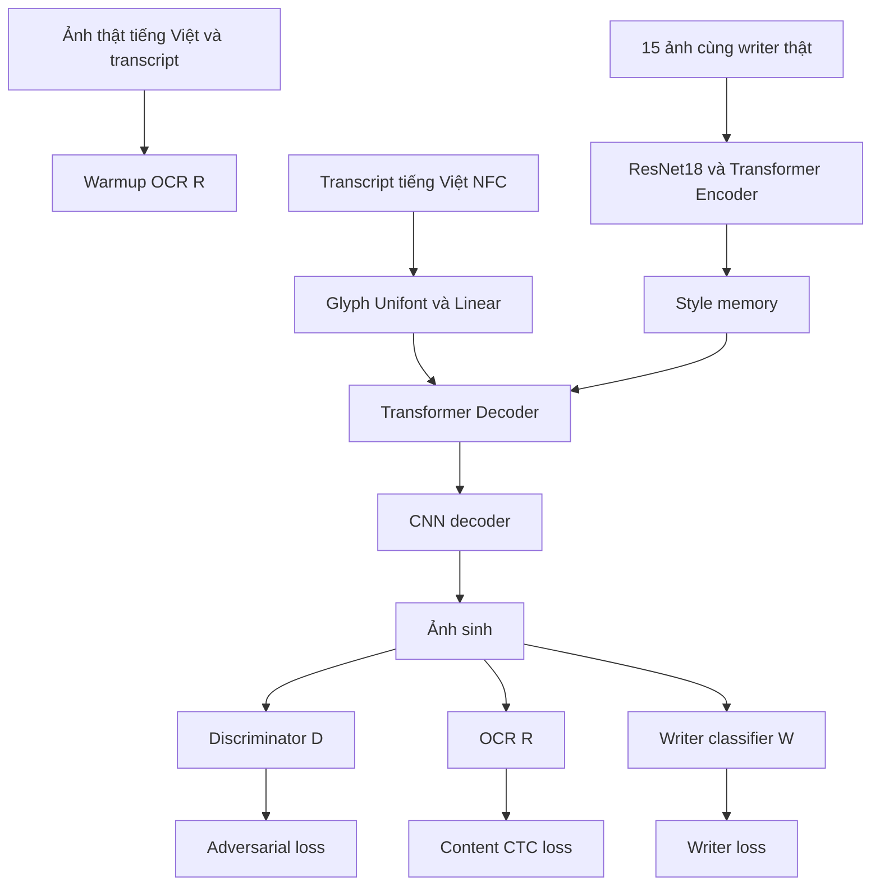

# VATr-pp cho tiếng Việt: thuật toán, thay đổi và nhật ký triển khai

> **Cập nhật training:** OCR đã được huấn luyện 20.000 bước và đã khởi chạy fine-tune G pretrained. Xem [nhật ký training mới](261111_report_02_Nhat_ky_training_tieng_Viet.md). Các số 51/4 bước bên dưới là snapshot smoke trước đó.

> Tài liệu mô tả mã trong repo tại thời điểm lập báo cáo ngày 11/11/2026.
> Đây là triển khai VATr-pp thích nghi với dữ liệu tiếng Việt. Đã hoàn thành
> pipeline và kiểm thử kỹ thuật; chưa huấn luyện mô hình hội tụ.

## Mục lục

1. [Mục tiêu và phạm vi](#1-mục-tiêu-và-phạm-vi)
2. [Ký hiệu và sơ đồ tổng thể](#2-ký-hiệu-và-sơ-đồ-tổng-thể)
3. [Dữ liệu và kết quả audit](#3-dữ-liệu-và-kết-quả-audit)
4. [Chuẩn hóa và tạo batch](#4-chuẩn-hóa-và-tạo-batch)
5. [Generator: học phong cách và nội dung](#5-generator-học-phong-cách-và-nội-dung)
6. [OCR và CTC](#6-ocr-và-ctc)
7. [Các hàm mất mát](#7-các-hàm-mất-mát)
8. [Lịch huấn luyện bốn pha](#8-lịch-huấn-luyện-bốn-pha)
9. [Sampling tiếng Việt](#9-sampling-tiếng-việt)
10. [Inference](#10-inference)
11. [Những action đã triển khai](#11-những-action-đã-triển-khai)
12. [Cấu hình và khả năng tái lập](#12-cấu-hình-và-khả-năng-tái-lập)
13. [Distribution shift và pretrain](#13-distribution-shift-và-pretrain)
14. [Kết quả đã kiểm chứng](#14-kết-quả-đã-kiểm-chứng)
15. [Giới hạn và công việc tiếp theo](#15-giới-hạn-và-công-việc-tiếp-theo)
16. [Lệnh sử dụng và bản đồ mã nguồn](#16-lệnh-sử-dụng-và-bản-đồ-mã-nguồn)

## 1. Mục tiêu và phạm vi

Bài toán là **styled handwritten text generation**: cho một tập ảnh chữ viết
của người A và một văn bản yêu cầu, sinh ảnh của văn bản đó theo phong cách A.

Ví dụ:

```text
Support của người A: ảnh “mỗi”, “dân”, “bé”, “có”, …
Văn bản yêu cầu:     “Tiếng Việt rất đẹp”
Đầu ra mong muốn:   ảnh viết đúng nội dung, giữ đặc trưng nét chữ của A.
```

Nội dung yêu cầu không cần trùng với nội dung support. Hệ thống phải học sử dụng
thông tin phong cách mà không chỉ sao chép nguyên ảnh mẫu.

### 1.1. Đây là VATr-pp, không phải SpiS-GAN

Mô hình được nhập trực tiếp từ repo VATr-pp:

- `Generator`: ResNet18, Transformer và CNN decoder.
- `UnifontModule`: visual archetypes.
- `Discriminator`: phân biệt ảnh thật/giả.
- `CRNN`: OCR, đường RNN hiện tắt trong mã.
- `WDiscriminator`: phân loại người viết.

Đường dẫn `/home/giaphk/SpiS-GAN/data/VNOnDB_ViHTGen_HAT2023` chỉ cung cấp dữ liệu
HDF5. Interpreter `/home/giaphk/SpiS-GAN/.venv/bin/python` được dùng vì có sẵn
thư viện cần thiết. Không import mạng, trainer hay checkpoint SpiS-GAN; không
sửa dự án và dữ liệu nguồn.

### 1.2. Mức độ giữ nguyên và thích nghi

Giữ các thành phần chính và lịch bốn pha của VATr-pp. Bổ sung loader HDF5,
chuẩn hóa tiếng Việt, OCR warmup, sampling theo nguồn/ký tự hiếm và sửa các vấn
đề tính đúng đắn. Cấu hình này không phải bản sao từng hyperparameter của thí
nghiệm IAM: dữ liệu, sampling, OCR classes và một số thao tác huấn luyện đã đổi.

## 2. Ký hiệu và sơ đồ tổng thể

| Ký hiệu | Ý nghĩa |
|---|---|
| B | Batch size |
| N | Số ảnh support, mặc định 15 |
| S_w | Tập ảnh support của người viết w |
| x, y | Ảnh thật và transcript của ảnh đó |
| t | Transcript cần sinh, có thể khác y |
| G | Generator |
| D | Discriminator thật/giả |
| R | OCR nhận dạng nội dung |
| W | Writer classifier |
| x_hat | Ảnh sinh G(S_w, t) |
| K | Số ký tự trong charset, hiện 207 |
| L | Số ký tự NFC của một transcript |

Mục tiêu sinh:

```math
\hat{x}=G(S_w,t)
```



Các nhánh D, R, W cung cấp gradient khi huấn luyện G. Khi inference chỉ cần G,
bộ chuyển văn bản thành ID và bảng glyph.

## 3. Dữ liệu và kết quả audit

### 3.1. Định dạng HDF5

Hai file nguồn là `train.h5` và `test.h5`. Mỗi file có:

| Dataset | Nội dung |
|---|---|
| `imgs` | Ảnh grayscale uint8 nối ngang, cao 32 pixel |
| `img_seek_idxs` | Cột bắt đầu của từng ảnh trong `imgs` |
| `img_lens` | Chiều rộng từng ảnh |
| `lbs` | Mảng Unicode code point nối tiếp |
| `lb_seek_idxs` | Vị trí bắt đầu nhãn |
| `lb_lens` | Độ dài nhãn |
| `wids` | ID người viết hoặc ID giả tùy nguồn |

Một ảnh được đọc bằng `imgs[:, start:start+width]`; transcript được tạo bằng
cách chuyển từng code point trong đoạn nhãn thành ký tự.

Đã kiểm tra số lượng, seek liên tiếp, độ dài dương và điểm cuối mảng. Không tạo
bản pickle chứa toàn bộ ảnh; loader đọc ảnh từ HDF5 khi cần.

### 3.2. Thành phần dữ liệu

| Nguồn train | Mẫu thô | Writer/group | Rộng min/median/max | Độ dài nhãn median/max |
|---|---:|---|---|---|
| VNOnDB | 66.955 | 106 writer thật | 16 / 48 / 176 | 3 / 11 |
| ViHTGen | 42.642 | 189 writer thật | 3 / 36 / 543 | 3 / 8 |
| HAT2023 | 103.000 | 103.000 ID theo ảnh | 6 / 55 / 245 | 4 / 17 |

Train thô có 212.597 mẫu. Test có 27.257 mẫu, 68 ID cục bộ và không chứa HAT.
Tổng cộng đã quét 239.854 mẫu.

Ý nghĩa ID được đối chiếu với tài liệu gộp dữ liệu của dự án nguồn: train
0–105 là VNOnDB, 106–294 là ViHTGen, từ 295 trở đi là HAT. Không áp cách ánh xạ
này cho ID test vì không gian ID test độc lập.

### 3.3. Vấn đề writer giả của HAT2023

Mẫu HAT thứ i được cấp ID 295+i. Mỗi ID chỉ có một ảnh, không đại diện cho một
người viết xác định. Vì vậy không đưa HAT vào:

- Writer head của GAN.
- Pool support cùng người viết.
- Tập ảnh thật dùng huấn luyện discriminator của cấu hình GAN hiện tại.

HAT được dùng cho OCR warmup và transcript cần sinh. Cách này khai thác coverage
nội dung mà không giả định có metadata phong cách đáng tin cậy.

### 3.4. Làm sạch và chia tập

Quy trình trong `scripts/prepare_vietnamese.py`:

1. Đọc metadata, transcript và quét pixel toàn bộ ảnh.
2. Chuẩn hóa NFC; kiểm tra nhãn rỗng, control characters, ảnh phẳng và CTC.
3. Hash kích thước và pixel bằng SHA-256.
4. Cách ly mọi nhóm cùng ảnh nhưng khác nhãn: 26 nhóm, tổng 53 mẫu HAT.
5. Chọn 30 writer development theo nguồn: 11 VNOnDB, 19 ViHTGen, seed 742.
6. Loại bản ảnh trùng. Thứ tự ưu tiên giữ là test, development, train, HAT.
7. Xây charset/corpus từ phần train đã lọc; kiểm tra glyph.
8. Ghi manifest và các artifact audit, không sửa dữ liệu nguồn.

Sau cách ly nhãn mâu thuẫn, loại 75 bản lặp trong train thật và 406 bản lặp HAT.
Trong lần quét này không thấy ảnh trùng pixel giữa các phần train/development/
test. Điều này không loại trừ near-duplicate hoặc writer HAT trùng với writer
của tập khác.

Theo hình học OCR VATr, có 2 mẫu ViHTGen, 8 HAT và 1 test thiếu timestep CTC.

| Split cuối | Mẫu giữ lại | Vai trò |
|---|---:|---|
| Train writer thật | 97.734 | GAN, OCR, corpus |
| Development | 11.786 | Đánh giá trên 30 writer thật không thuộc train thật |
| HAT OCR | 102.533 | OCR warmup và corpus |
| Test | 27.256 | Đánh giá cuối sau lọc CTC |

Train phong cách còn 265 writer, remap thành nhãn phân loại 0–264.

### 3.5. Độ phủ tiếng Việt

Charset có 207 ký tự, gồm 186 chữ cái, 10 chữ số và 11 ký tự khác gồm khoảng
trắng/dấu câu. Không lấy ký tự development/test để xây charset. Mọi ký tự có
trong hai tập đánh giá đều được charset train bao phủ.

Có 44 ký tự chỉ HAT cung cấp trong phần train, chủ yếu chữ hoa có dấu như `Ắ`,
`Ễ`, `Ỡ`, `Ự`, `Ỹ`, cùng `Z` và `ỵ`. Chúng có dữ liệu học OCR nhưng không có mẫu
theo writer thật để giám sát phong cách trực tiếp.

Các dấu `! ? ; " '` chưa có dữ liệu trong charset. Pipeline báo lỗi nếu yêu cầu
sinh các ký tự này, thay vì xóa chúng khỏi nội dung.

## 4. Chuẩn hóa và tạo batch

### 4.1. Unicode NFC

Một chữ hiển thị như `ệ` có thể được mã hóa bằng code point dựng sẵn hoặc bằng
`e` và nhiều combining marks. NFC đưa các biểu diễn tương đương về cách biểu
diễn thống nhất khi có dạng dựng sẵn.

Trong pipeline này:

```text
“Việt” → [V, i, ệ, t] → 4 vị trí
```

Không tách thân chữ, dấu mũ và dấu thanh thành token độc lập. Điều này tránh
cấp thêm chiều rộng cho từng combining mark khi dùng quy ước 16px/vị trí.

Mã ký tự dùng ID 1…K. ID 0 dùng cho padding query và CTC blank ở hai nhánh tương
ứng. Bitmap tại vị trí 0 là ảnh rỗng; vector sau linear có thể vẫn có bias.

### 4.2. Ảnh và chiều rộng

Chuẩn hóa pixel:

```math
x_{norm}=x/127.5-1
```

- Nền trắng: +1.
- Nét đen: gần -1.
- OCR warmup giữ chiều rộng tự nhiên của ảnh.
- Ảnh thật của GAN được resize về rộng 16 nhân số ký tự NFC để khớp quy ước
  tổng chiều rộng ảnh sinh.
- Support cao 32, pad trắng tới 192px; nếu rộng hơn thì nén ngang toàn ảnh,
  không cắt bỏ suffix.
- Batch pad tới ảnh rộng nhất, đồng thời giữ chiều rộng thật từng mẫu.

Resize theo số ký tự có thể làm méo tỷ lệ ngang; đây là đánh đổi để giữ baseline
hình học đầu ra của VATr, không phải giải pháp tối ưu cho mọi kiểu chữ Việt.

### 4.3. Lấy support

Một target thuộc writer w được ghép với N ảnh trong pool writer w:

1. Ưu tiên các ảnh có transcript khác transcript target.
2. Nếu không có, lấy ảnh khác chỉ số target.
3. Lấy không lặp khi đủ mẫu; nếu thiếu thì lấy có hoàn lại.

Do đó support không chứa chính ảnh target, nhưng các ảnh support có thể lặp
nhau khi pool phù hợp quá nhỏ. Không dùng transcript support làm đầu vào cho
nhánh style; nhãn ở đây chỉ giúp tránh shortcut trong việc chọn mẫu.

Tensor support:

```math
S\in\mathbb{R}^{B\times N\times32\times192},\quad N=15
```

## 5. Generator: học phong cách và nội dung

### 5.1. Nhánh phong cách: ResNet18

Gộp B và N, đưa từng ảnh qua ResNet18 nhận ảnh một kênh. Thay `fc` và `avgpool`
bằng identity để giữ đặc trưng ảnh trước lớp phân loại.

Với ảnh 32×192, đặc trưng cuối có hình học 512×1×6 trước flatten của ResNet.
Các đặc trưng từ N ảnh được chuyển thành một chuỗi vector cho Transformer.

Mục tiêu học gồm độ nghiêng, độ đậm, cấu trúc nét, cách nối và biến thiên nét.
Không có bảo đảm chuỗi này chỉ chứa phong cách: nó cũng có thể chứa nội dung,
nền giấy hoặc kẻ dòng.

### 5.2. Transformer Encoder và style memory

Cấu hình trong `models/config.py`:

| Tham số | Giá trị |
|---|---:|
| Hidden dimension | 512 |
| Attention heads | 8 |
| Encoder layers | 3 |
| Decoder layers | 3 |
| Feedforward dimension | 512 |
| Dropout | 0,1 |

Encoder tổng hợp chuỗi đặc trưng thành memory. Decoder có thể truy cập nhiều
vector memory thay vì chỉ một vector phong cách toàn cục.

**Lưu ý về tensor layout:** mặc định giữ phép `view(B, 512, 1, -1)` của repo gốc.
Do ResNet trả dữ liệu gộp theo từng ảnh, phép view trực tiếp không giữ cách nhóm
kênh/không gian như cách ghép feature chuẩn theo từng ảnh. Vì vậy không nên gán
mỗi token memory mặc định cho một vùng ảnh cục bộ cụ thể. Với N=15, chiều dài
chuỗi vẫn là 15×6=90, nhưng cách phân bố giá trị chịu ảnh hưởng phép reshape.

Đã thêm một đường thay thế ghép feature rõ theo `[B,N,512,spatial]` rồi permute,
nhưng chỉ bật bằng `--adapt-generator-layout`. Chưa có kết quả dài hạn so sánh.

### 5.3. Nhánh nội dung: visual archetypes

Mỗi ký tự được ánh xạ sang bitmap Unifont, thay vì chỉ embedding theo ID:

```text
“ệ” → glyph bitmap 16×16 → vector 256 chiều → Linear → vector 512 chiều
```

```math
q_i=W_q\,\operatorname{vec}(A(c_i))+b_q
```

Glyph không phải ảnh viết tay mục tiêu; nó cung cấp cấu trúc hình học chuẩn.
Những chữ như `a`, `á`, `à`, `â` chia sẻ nhiều cấu trúc nên mô hình có cơ hội
chuyển giao thông tin thị giác giữa các ký tự.

Tất cả glyph cần thiết đã được kiểm tra. Glyph được đăng ký làm buffer không
persistent: theo device của module nhưng không tạo thêm tensor vào state dict
legacy. File glyph có checksum trong manifest.

Có glyph không bảo đảm sinh đúng chữ hoặc đúng phong cách khi chưa có dữ liệu
học phù hợp. Đây là khả năng biểu diễn đầu vào, không phải chứng nhận zero-shot.

### 5.4. Transformer Decoder

Decoder nhận target ban đầu bằng zero, query glyph và style memory:

- Self-attention trao đổi thông tin giữa các vị trí nội dung.
- Cross-attention truy cập memory phong cách.
- Feedforward và residual/layer normalization xử lý đặc trưng từng vị trí.

```math
\operatorname{Attention}(Q,K,V)
=\operatorname{softmax}(QK^T/\sqrt{d})V
```

Trong cross-attention, Q thuộc nhánh nội dung, K/V thuộc memory phong cách.
Decoder xử lý các vị trí song song, không có vòng lặp autoregressive từng chữ.
Query padding có mask theo ID 0.

Mặc định **không cộng positional encoding tường minh vào query**, giữ hành vi
repo gốc. `--adapt-generator-layout` bật cả thay đổi layout style và positional
encoding query, nên đây là thí nghiệm thay đổi hai yếu tố, chưa phải ablation
tách biệt từng yếu tố. Các vị trí glyph giống nhau có thể khó được phân biệt
trong Transformer mặc định; CNN phía sau vẫn xử lý theo thứ tự không gian.

### 5.5. CNN dựng ảnh

Đầu ra mỗi vị trí 512 chiều được chiếu lên 4096 chiều rồi reshape:

```math
[B,L,512]\rightarrow[B,L,4096]\rightarrow[B,512,4,2L]
```

CNN decoder có residual blocks, ba lần upsample ×2 và convolution, cuối cùng
`tanh` đưa giá trị ảnh về khoảng [-1,1]:

```text
Feature map:  4 × 2L
Upsample 1:   8 × 4L
Upsample 2:  16 × 8L
Upsample 3:  32 × 16L
```

```math
\hat{x}\in\mathbb{R}^{B\times1\times32\times16L}
```

“Việt” có 4 vị trí NFC nên ảnh rộng 64px. Đây là quy ước tổng chiều rộng; không
ép nét mỗi ký tự nằm độc lập trong một ô 16px vì các convolution có thể tạo
nét nối qua ranh giới vị trí.

## 6. OCR và CTC

### 6.1. Kiến trúc OCR thực tế

Lớp tên `CRNN` nhưng `use_rnn=False`; đường chạy là CNN → linear classifier,
không chạy LSTM. OCR có K+1=208 lớp, gồm blank ở ID 0.

Đầu ra log-probabilities:

```math
R(x)\in\mathbb{R}^{T\times B\times208},\quad
T=\lfloor W/4\rfloor+1
```

CTC yêu cầu log-probabilities, vì vậy `forward()` trả `log_softmax` thay vì raw
logits. True input lengths tính riêng từ chiều rộng mỗi ảnh, không lấy chiều
rộng padding của cả batch làm độ dài cho mọi mẫu.

### 6.2. Ý nghĩa CTC

Có transcript nhưng không có vị trí chính xác từng ký tự. CTC cộng xác suất
qua các alignment hợp lệ:

```math
L_{CTC}(x,t)=-\log\sum_{\pi\in\mathcal{B}^{-1}(t)}P(\pi\mid x)
```

Ví dụ:

```text
[V, V, blank, i, i, ệ, blank, t, t] → Việt
[a, blank, a]                       → aa
```

Hàm collapse gộp các ký tự giống nhau liên tiếp rồi bỏ blank. Để biểu diễn
nhãn có ký tự lặp liền nhau, cần đủ timestep phân tách:

```math
T_{min}=L+\sum_{i=2}^{L}\mathbf{1}[t_i=t_{i-1}]
```

Cấu hình mới không âm thầm zero các alignment bất khả thi; kiểm tra điều kiện
và báo lỗi nếu dữ liệu/geometry không khớp. Loss dùng `reduction='mean'` của
PyTorch, có chuẩn hóa theo target length trước khi lấy trung bình.

### 6.3. Vì sao thêm warmup OCR tiếng Việt?

G nhận gradient nội dung từ OCR. Nếu OCR chưa phân biệt `ma`, `má`, `mã`, `mạ`,
thì bộ giám sát nội dung cũng chưa đủ tin cậy cho những khác biệt đó.

Warmup học bằng ảnh thật của cả ba nguồn. Sau warmup, vào GAN mặc định OCR vẫn
được cập nhật trên ảnh thật trong pha D_OCR; không train OCR bằng nhãn ảnh giả.
`--freeze-ocr` là ablation giữ OCR cố định trong giai đoạn GAN.

## 7. Các hàm mất mát

### 7.1. Adversarial hinge loss

```math
L_D=E_x[\max(0,1-D(x))]+E_{\hat{x}}[\max(0,1+D(\hat{x}))]
```

```math
L_{adv}=-E_{\hat{x}}[D(\hat{x})]
```

D học phân biệt ảnh thật/giả. G học tăng điểm D của ảnh sinh. D không nhận
transcript làm điều kiện, nên adversarial loss không bảo đảm đúng chính tả.

D dùng các residual blocks, spectral normalization và global sum pooling theo
mã BigGAN trong repo. Khi bật crop, xác suất khoảng 0,33 áp dụng crop ngang;
chiều rộng crop chọn trong 64–128, giữ chiều cao. Đây không phải patch loss
riêng cho dấu; không có foreground/diacritic discriminator mới.

### 7.2. Content loss qua OCR

```math
L_{content}=L_{CTC}(R(G(S_w,t)),t)
```

Khi cập nhật G, khóa tham số R và chuyển R sang eval nhưng vẫn giữ đồ thị tính
toán theo ảnh. Gradient đi xuyên qua OCR về G. Nếu đặt OCR trong `no_grad()` ở
pha này thì G sẽ không nhận được gradient nội dung.

### 7.3. Writer loss

Writer classifier được học từ ảnh thật:

```math
L_W^{real}=CE(W(x),w)
```

G nhận loss phong cách:

```math
L_{style}=CE(W(G(S_w,t)),w)
```

W phân loại 265 writer train. Writer loss khuyến khích đặc trưng nhận diện người
viết, nhưng có thể khai thác background/source shortcut. Không đồng nghĩa loss
thấp là đã giữ đúng mọi chi tiết nét chữ; generalization sang writer mới cần
đánh giá riêng. Khi inference không cần phân loại writer mới thành một lớp W.

### 7.4. Gradient balancing

Với auxiliary loss là OCR hoặc writer:

```math
g_{adv}=\nabla_{\hat{x}}L_{adv},\qquad
g_{aux}=\nabla_{\hat{x}}L_{aux}
```

```math
a=\operatorname{clip}\left(
0.7\frac{\operatorname{std}(g_{adv})}
{\operatorname{std}(g_{aux})+10^{-7}},10^{-4},1000\right)
```

```math
L_G=L_{adv}+\lambda\,\operatorname{stopgrad}(a)L_{aux}
```

Hệ số được detach; không tối ưu gradient bậc cao qua a. Sau khi cộng loss, chỉ
backward một lần. Clip gradient norm tại 5 và báo lỗi nếu loss/gradient không
hữu hạn, thay vì tiếp tục với giá trị NaN/Inf.

Không có loss trực tiếp so sánh ảnh sinh với glyph, không có pixel L1 với ảnh
thật target, và trainer Việt hiện không bật cycle loss. Transcript sinh thường
khác transcript ảnh thật nên không có cặp ảnh pixel-aligned để dùng L1 đơn giản.

## 8. Lịch huấn luyện bốn pha

Một batch gồm ảnh thật x, nhãn y, writer w và support S_w. Bốn pha giữ thứ tự
của `train.py` gốc; mỗi pha lấy lại transcript và sinh lại fake.

| Pha | G cập nhật | D cập nhật | R cập nhật | W cập nhật |
|---|---|---|---|---|
| G_OCR | Adversarial + content | Không | Không | Không |
| D_OCR | Không | Hinge | CTC ảnh thật, trừ khi freeze | Không |
| G_W | Adversarial + writer | Không | Không | Không |
| D_W | Không | Hinge | Không | CE ảnh thật |

Pseudo-code:

```python
for batch in train_loader:
    x, y, writer, support = unpack(batch)
    for phase in ["G_OCR", "D_OCR", "G_W", "D_W"]:
        text = sample_vietnamese_transcripts()
        fake = G(support, encode(text))
        fake = mask_padded_suffix_to_white(fake, text_lengths)

        if phase == "G_OCR":
            freeze(D, R, W)
            update(G, adversarial(fake) + balanced_ocr(fake, text))
        elif phase == "D_OCR":
            update(D, hinge(x, fake.detach()))
            if not freeze_ocr:
                update(R, ctc(R(x), y))
        elif phase == "G_W":
            freeze(D, R, W)
            update(G, adversarial(fake) + balanced_writer(fake, writer))
        elif phase == "D_W":
            update(D, hinge(x, fake.detach()))
            update(W, cross_entropy(W(x), writer))
```

Trong code thực tế fake ở pha D được tính trong `no_grad()` để tiết kiệm bộ
nhớ. Generator vẫn ở train mode trong các pha, nên BatchNorm running statistics
có thể cập nhật cả ở forward không tạo gradient. D/R/W dùng eval mode khi khóa
để cung cấp gradient cho G. Hai loss D và R/W được cập nhật bằng optimizer riêng.

Một outer step gồm 2 optimizer step G, 2 D, 1 R và 1 W mặc định. Khi freeze OCR
thì không có optimizer step R. Vì vậy phải phân biệt outer step với optimizer
step hoặc epoch khi so sánh thời gian/công bằng thí nghiệm.

## 9. Sampling tiếng Việt

### 9.1. OCR warmup

Dùng 200.267 mẫu sau lọc. Trọng số mỗi ảnh nghịch đảo số ảnh của nguồn; do đó
xác suất nguồn kỳ vọng là 1/3 cho mỗi VNOnDB, ViHTGen và HAT. Đây là lấy mẫu có
hoàn lại, không bảo đảm mỗi batch có đúng tỷ lệ 1/3.

### 9.2. GAN real-image sampling

Chỉ dùng hai nguồn có writer thật. Trọng số mỗi ảnh:

```math
weight(x)=\frac{1}{n_{writer(x)}\,N_{writers,source(x)}}
```

Tổng xác suất cân bằng hai nguồn, sau đó cân bằng writer trong từng nguồn.
Các writer có nhiều ảnh không tự động chiếm ưu thế.

### 9.3. Transcript cần sinh

Mặc định chọn corpus:

```math
P(HAT)=0.35,\qquad P(real\ writers)=0.65
```

Trong từng corpus, 70% lượt lấy từ phân phối transcript thực nghiệm, 30% dùng
trọng số ưu tiên ký tự hiếm. Với U(t) là tập ký tự khác nhau trong transcript,
N_corpus là số transcript và f(c) là số lần ký tự c xuất hiện:

```math
weight(t)=\min\left(20,
\frac{1}{|U(t)|}\sum_{c\in U(t)}\sqrt{\frac{N_{corpus}}{f(c)}}\right)
```

Chỉ lấy transcript train không rỗng, dài tối đa 20 vị trí. Chọn transcript có
thật thay vì random thay dấu/chữ như proportional substitution trong VATr++
gốc. Đây là thay đổi sampling có chủ đích cho miền tiếng Việt, cần ablation.
Không có language model hay ràng buộc ngữ pháp tiếng Việt được thêm vào.

`--no-hat` loại HAT khỏi OCR và transcript sinh; nếu dùng cờ này ở GAN thì OCR
checkpoint cũng phải được train bằng `--no-hat`. `--hat-fraction 0` chỉ bỏ HAT
khỏi transcript sinh, không loại ảnh hưởng HAT đã có trong OCR pretrained.

## 10. Inference

`generate_vietnamese.py` thực hiện:

1. Nạp checkpoint GAN và charset đúng cấu hình.
2. Nạp manifest, kiểm tra glyph và dữ liệu.
3. Chuẩn hóa text NFC, báo lỗi OOV/chuỗi rỗng.
4. Chọn N support cùng writer hoặc từ style folder người dùng cung cấp.
5. Tính memory một lần.
6. Tách text theo khoảng trắng, sinh từng đơn vị rồi ghép cách nhau 16px.
7. Lưu ảnh, ảnh support và JSON ghi nguồn tham chiếu/seed/checkpoint.

Với tiếng Việt, đơn vị ngăn bằng khoảng trắng thường là âm tiết chứ không
nhất thiết là một từ ngôn ngữ học hoàn chỉnh. Không có mô hình sinh liên tục
cả câu hay học nét nối qua khoảng trắng trong đường inference này.

Additive noise tắt mặc định. Với cùng support và eval mode, không có nguồn
noise latent chủ động; lựa chọn support khác nhau vẫn có thể đổi kết quả.

## 11. Những action đã triển khai

### 11.1. Tệp mới

| Tệp | Action và mục đích |
|---|---|
| `scripts/prepare_vietnamese.py` | Audit đủ dữ liệu; lọc CTC/nhãn/ảnh trùng; tách writer; xuất manifest, charset, glyph subset, corpus và contact sheet |
| `data/vietnamese.py` | Loader HDF5 lazy theo process, batch padding, support cùng writer, cân bằng nguồn/writer và sampling transcript hiếm |
| `train_vietnamese.py` | OCR warmup và GAN bốn pha; true-width CTC; gradient balancing; checkpoint/resume; metrics và preview |
| `generate_vietnamese.py` | Sinh NFC Việt từ checkpoint mới, support HDF5 hoặc folder, kiểm tra OOV và lưu reference sidecar |
| `tests/test_vietnamese.py` | Kiểm thử Unicode, blank/log-probs, CTC repeat/width/gradient, support và writer IDs |
| `requirements-vietnamese.txt` | Dependency cho đường chạy Việt, không yêu cầu wandb/streamlit |
| `docs/VIETNAMESE.md` | Audit và hướng dẫn vận hành |
| `docs/261111_report_01_Thuat_toan_va_trien_khai_VATr_pp_tieng_Viet.md` | Tài liệu thuật toán và báo cáo triển khai này |

### 11.2. Tệp đã sửa

| Tệp | Thay đổi | Ý nghĩa/giới hạn |
|---|---|---|
| `models/OCR_network.py` | K+1 lớp, `log_softmax`, NFC, xử lý chuỗi đơn, báo lỗi OOV/rỗng | Đúng giao diện CTC; OCR head đổi shape nên không resume nguyên head tiếng Anh cũ |
| `models/unifont_module.py` | Đường dẫn glyph cấu hình được; registered nonpersistent buffers | Dùng glyph Việt và theo device module; vẫn là visual archetype gốc |
| `models/model.py` | Điều khiển tải ImageNet; đường layout/position tùy chọn; query padding mask | Trainer Việt không tự tải pretrained; layout/position mới mặc định tắt |
| `models/model.py` | Hai hàm backward G đang được trainer legacy gọi chỉ backward tổng loss một lần | Sửa tích lũy gradient nhiều lần; trainer Việt cũng dùng nguyên tắc này |
| `models/model.py` | Fake history detach; cờ OCR augmentation có hiệu lực; clean_grad bỏ qua grad None | Giảm giữ graph và làm cờ hoạt động đúng ở lớp VATr legacy |
| `models/model.py` | Bỏ ngắt gradient trong cycle loss, thay hard-code 15 bằng N thực | Chỉ sửa đường cycle legacy; trainer Việt không dùng cycle |
| `data/dataset.py` | Cộng writer offset khi ghép nhiều dataset | Tránh các writer khác dataset bị chung class ID; loader Việt có remap riêng |
| `generate/writer.py` | NFC và báo lỗi OOV thay lọc mất ký tự | Tránh âm thầm bỏ dấu trong đường inference legacy |
| `README.md` | Thêm entry và lệnh cho tiếng Việt | Dẫn tới hướng dẫn mới |
| `.gitignore` | Bỏ qua dataset artifacts, runs, local venv | Không đưa checkpoint/dữ liệu phát sinh vào Git |

Không tuyên bố đã dọn sạch mọi hàm legacy: repo còn các nhánh huấn luyện cũ;
phần đã kiểm chứng cho dữ liệu Việt là entrypoint mới và các component mà nó
sử dụng. Không thay đổi các tệp có sẵn ngoài phạm vi VATr-pp trong workspace.

### 11.3. Những thay đổi đặc thù tiếng Việt và những sửa lỗi chung

| Nhóm | Thay đổi |
|---|---|
| Thích nghi ngôn ngữ | NFC, charset/glyph Việt, corpus Việt, OCR warmup và sampling ký tự hiếm |
| Thích nghi dataset | Đọc HDF5, nhận diện writer giả HAT, tách writer thật, cân bằng nguồn, cách ly nhãn mâu thuẫn |
| Bảo vệ chi tiết ảnh | Không cắt suffix support, không augmentation mạnh trong cấu hình đầu |
| Sửa lỗi chung | CTC blank/log-probabilities, true widths, backward một lần, device buffers, writer offsets |
| Thử nghiệm kiến trúc | Layout style và query position, chỉ bật qua flag, chưa xác nhận lợi ích |

## 12. Cấu hình và khả năng tái lập

| Tham số | Mặc định hiện tại |
|---|---|
| Image height / width per character | 32 / 16 |
| Support count / width | 15 / 192 |
| Charset / OCR classes | 207 / 208 |
| Seed | 742 |
| G encoder learning rate | 1e-5 |
| G phần còn lại | 5e-5 |
| D learning rate | 1e-5 |
| W và OCR trong GAN | 5e-5 |
| G/D/W Adam betas | (0, 0.999) |
| OCR Adam | Mặc định PyTorch, betas (0.9, 0.999) |
| Gradient norm clip | 5 |
| Gradient balancing | Bật |
| Discriminator crop | Bật |
| Query position / layout mới | Tắt |
| Cycle loss / additive noise | Tắt |
| HAT transcript fraction / rare fraction | 0.35 / 0.30 |
| Save / eval interval | 1.000 outer step |

Batch size mặc định CLI là 8; hướng dẫn OCR dùng batch 16. Lệnh GAN gợi ý
50.000 outer step; đây không phải ngưỡng hội tụ đã được đo.

Checkpoint lưu network states, optimizer states, stage, step, charset, config,
manifest SHA-256 và RNG Python/NumPy/PyTorch/CUDA. Nguồn HDF5 được kiểm tra
size/mtime, không tính lại full file hash mỗi lần mở; glyph có checksum riêng.

Resume kiểm tra stage/manifest và một số flag chính. Model/optimizer/RNG được
khôi phục nhưng iterator sampler khởi động lại, nên không khẳng định khớp bit
với run liên tục. Các tham số như batch, sampling fractions và mọi provenance
khởi tạo vẫn cần được người chạy quản lý nhất quán; không coi kiểm tra resume
hiện tại là kiểm tra tất cả hyperparameter.

`last.pth` lưu trạng thái mới nhất theo interval. OCR có `best.pth` theo CER
development; GAN chưa chọn best checkpoint theo một metric chất lượng độc lập.

## 13. Distribution shift và pretrain

### 13.1. Các loại shift cần tách biệt

| Shift | Biểu hiện | Cách xử lý đã có |
|---|---|---|
| Ký tự | Chữ Việt có dấu khác alphabet IAM | Charset, glyph và OCR Việt |
| Transcript | Corpus tiếng Anh khác âm tiết Việt | Corpus train Việt, sampling hiếm |
| Geometry | Dấu kép, dấu nặng, crop sát | NFC, kiểm tra ảnh, không crop suffix; vẫn giới hạn 32px |
| Source | Nền trắng so với giấy xám/kẻ dòng | Sampling cân bằng; chưa tách nền |
| Writer metadata | HAT thiếu nhóm người thật | Không dùng HAT cho writer/style |
| Pretrained weights | Bias từ dữ liệu nguồn | Hỗ trợ nạp G/encoder và cấu hình ablation |

### 13.2. Tình trạng pretrain thực tế

Trong thư mục VATr-pp không có checkpoint generator/Font Square được cung cấp
để dùng trong smoke test. Trainer Việt đặt `imagenet_weights=False`; G và
encoder trong smoke test khởi tạo từ đầu.

Có hỗ trợ:

- `--generator-checkpoint`: nạp phần G theo tên key và shape tương thích.
- `--encoder-checkpoint`: nạp ResNet pretrained, chuyển kernel RGB sang gray.

Không nạp OCR/writer head tiếng Anh vào cấu hình Việt. Hai cách khởi tạo G và
encoder không được dùng đồng thời ở entrypoint này. Nạp partial ghi danh sách
loaded/missing; phải kiểm tra danh sách đó, không mặc định mọi trọng số đều khớp.

**Ảnh nhiễu sau 4 bước hiện tại không phải bằng chứng negative transfer từ
pretrain tiếng Anh**, vì G trong run đó chưa nạp pretrained. Muốn kiểm định giả
thuyết cần so sánh cùng dữ liệu, seeds, sampling, bước và cách đánh giá:

1. G scratch + OCR Việt.
2. G pretrained VATr-pp + OCR Việt.
3. Encoder pretrained + phần G còn lại scratch, nếu có tài nguyên.

Giữ layout mặc định khi muốn so sánh đúng cấu trúc gốc. Nếu bật layout/position
mới thì phải xem đó là một thí nghiệm kiến trúc khác.

## 14. Kết quả đã kiểm chứng

### 14.1. Test và integration

- 4 unit test qua: NFC/OOV, lớp blank/log-probs, CTC repeat/true width/gradient,
  writer remap/support và loại HAT khỏi style dataset.
- Quét đủ 239.854 mẫu; kiểm tra metadata, pixel hash, Unicode và glyph coverage.
- Loader chạy với DataLoader hai workers: ảnh batch và support có shape đúng.
- OCR chạy 50 bước, lưu checkpoint rồi resume lên 51.
- GAN chạy 3 outer step, đủ bốn pha rồi resume lên 4; batch 2 và 15 support.
- Nạp G mới để sinh “Tiếng Việt rất đẹp” từ writer development ID 35, lưu cả
  support và metadata.
- Compile các module đã thêm/sửa và `git diff --check` qua ở lần kiểm tra.

Các kiểm chứng này xác nhận đường chạy và loss/gradient hữu hạn trong run ngắn,
không xác nhận hội tụ, khả năng sinh đúng dấu hoặc giữ writer ở quy mô dài hạn.

### 14.2. Chỉ số hiện có

| Thành phần | Mốc | Kết quả và cách hiểu |
|---|---|---|
| OCR | 51 bước, batch 16 | CER 0.97156 trên 64 mẫu đầu development; rất kém |
| OCR bỏ dấu | Cùng 64 mẫu | CER khoảng 0.95735; lỗi không chỉ nằm ở dấu |
| Transcript error rate | Cùng 64 mẫu | 1.0, chưa có transcript đúng hoàn toàn trong mẫu này |
| GAN | 4 outer step | Ảnh nhiễu/hoa văn, chưa đọc được |
| Chất lượng G độc lập | Chưa đo | Chưa có CER từ OCR độc lập hoặc đánh giá writer đầy đủ |

Không suy rộng CER trên 64 mẫu đầu thành CER toàn development. Trong các lần
kiểm tra trạng thái gần nhất không có training dài hạn đang chạy. Các con số
là snapshot triển khai, không tự tăng khi agent không chạy tiến trình training.

Artifact cuối:

- [OCR metrics](../runs/vatrpp_vn_ocr_smoke/validation_000051.json).
- [Ảnh sinh smoke](../runs/vatrpp_vn_gan_smoke/inference.png).
- [Support của ảnh sinh](../runs/vatrpp_vn_gan_smoke/inference.references.png).
- [Metadata inference](../runs/vatrpp_vn_gan_smoke/inference.json).
- `runs/vatrpp_vn_ocr_smoke/last.pth` và `best.pth`.
- `runs/vatrpp_vn_gan_smoke/last.pth`.

Các thư mục `vn_*` khác là run thử trước khi chốt manifest/lịch bốn pha; không
sử dụng chúng làm kết quả cuối hoặc resume cho cấu hình đã chốt.

### 14.3. Tốc độ và giới hạn ước tính

Trên H200, PyTorch 2.9.1+cu128:

- OCR batch 16: khoảng 0,04–0,06 giây/bước sau khởi động trong run 50 bước.
- GAN batch 2, 15 support: hai bước sau khởi động khoảng 0,42 giây/outer step.
- Ngoại suy thuần số học 50.000 bước ở tốc độ GAN batch 2 trên là khoảng 5,8 giờ,
  chưa tính overhead và biến thiên. Không phải số đo run dài hoặc batch 8.
- Chưa benchmark đủ 500–1.000 bước ở batch 8 để cam kết ETA cho cấu hình đề xuất.
- Số bước gợi ý không bảo đảm hội tụ. Thời gian đạt chất lượng cần dựa vào
  development curves, không chỉ thời gian hoàn thành một số bước cố định.

## 15. Giới hạn và công việc tiếp theo

### 15.1. Những thứ chưa được triển khai hoặc chưa xác nhận

- Chưa có mô hình tiếng Việt đã train hội tụ.
- Chưa có phép tách token thân chữ/dấu hoặc loss riêng cho vị trí dấu.
- Chưa có foreground mask, background normalization hoặc loss tách nền.
- Chưa có generator 64px và chưa lấy lại ảnh nguồn độ phân giải cao.
- Chưa có language model tiếng Việt hoặc autoregressive sentence generator.
- Chưa có panel GAN development cố định và tự động chấm CER độc lập.
- Chưa có thí nghiệm chứng minh sampling 0.35/0.30 là tốt nhất.
- Chưa có so sánh scratch/pretrained để kết luận distribution shift từ weights.
- Chưa chứng minh writer HAT độc lập với writer trong các tập đánh giá.

### 15.2. Trình tự tiếp theo

1. Benchmark đúng batch/độ dài ảnh mục tiêu để đo thời gian và bộ nhớ.
2. Train OCR đủ dài, đánh giá toàn development; xem CER có dấu/bỏ dấu, chữ hoa,
   và các nhóm ký tự hiếm. Chưa có ngưỡng CER cứng được xác lập.
3. Tạo panel cố định: writer chưa gặp, cùng support/text/seed giữa checkpoint.
4. Train GAN dài hạn bằng OCR đủ tin cậy, theo dõi ảnh và loss.
5. Đánh giá ảnh G bằng OCR độc lập và kiểm tra độ giống writer.
6. Chạy ablation: pretrained, no-HAT, HAT transcript fraction, rare sampling,
   freeze OCR và thí nghiệm layout/position riêng.
7. Chỉ sau khi có baseline đáng tin cậy mới quyết định đổi độ phân giải hoặc
   thêm mô hình thành phần dấu; tránh gán mọi lỗi cho pretrain từ đầu.

## 16. Lệnh sử dụng và bản đồ mã nguồn

Chạy từ thư mục `hand_writting/VATr-pp` với môi trường đủ dependency. Môi trường
đã dùng kiểm thử là `/home/giaphk/SpiS-GAN/.venv/bin/python`; có thể thay `python`
bên dưới bằng đường dẫn này hoặc tạo venv riêng theo [hướng dẫn vận hành](VIETNAMESE.md).

### 16.1. Chuẩn bị dữ liệu

```bash
python scripts/prepare_vietnamese.py \
  --data /home/giaphk/SpiS-GAN/data/VNOnDB_ViHTGen_HAT2023 \
  --glyphs ../VATr/files/unifont.pickle \
  --output files/vietnamese
```

Artifact audit gồm `manifest.json`, `audit.json`, `characters.csv`,
`ambiguous_labels.json`, `charset.json`, `unifont.pickle`, `corpus.txt` và
`contact_sheet.png` trong `files/vietnamese/`.

### 16.2. OCR warmup

```bash
python train_vietnamese.py --stage ocr \
  --manifest files/vietnamese/manifest.json \
  --output runs/vatrpp_vn_ocr \
  --steps 20000 --batch-size 16 --workers 2
```

Đánh giá OCR trước khi chuyển sang GAN. Không lấy OCR smoke 51 bước làm bộ giám
sát cho một run được kỳ vọng có chất lượng.

### 16.3. GAN VATr-pp

```bash
python train_vietnamese.py --stage gan \
  --manifest files/vietnamese/manifest.json \
  --ocr-checkpoint runs/vatrpp_vn_ocr/best.pth \
  --output runs/vatrpp_vn_gan \
  --steps 50000 --batch-size 8 --num-examples 15 --workers 2
```

Muốn fine-tune G pretrained VATr-pp, thêm `--generator-checkpoint /path/to/vatrpp.pth`.
Đó là khởi tạo trọng số, không phải resume toàn bộ optimizer của run tiếng Anh.

### 16.4. Resume

```bash
python train_vietnamese.py --stage gan \
  --output runs/vatrpp_vn_gan \
  --resume runs/vatrpp_vn_gan/last.pth \
  --steps 100000 --batch-size 8 --num-examples 15 --workers 2
```

`--steps` là tổng outer step gồm cả phần đã chạy. Nếu ban đầu dùng manifest
khác mặc định thì phải truyền lại đúng `--manifest` khi resume.

### 16.5. Sinh ảnh

```bash
python generate_vietnamese.py \
  --checkpoint runs/vatrpp_vn_gan/last.pth \
  --writer 35 --split val \
  --text 'Tiếng Việt rất đẹp' \
  --output runs/vatrpp_vn_gan/example.png
```

Hoặc thay `--writer` bằng `--style-folder /path/to/images` để dùng chữ mẫu ngoài
HDF5. Mặc định văn bản được sinh theo đơn vị ngăn bằng khoảng trắng.

### 16.6. Các điểm đọc mã chính

| Câu hỏi | Mã nguồn |
|---|---|
| Audit và split làm gì? | [prepare_vietnamese.py](../scripts/prepare_vietnamese.py) |
| Đọc HDF5, chọn support và sampling? | [vietnamese.py](../data/vietnamese.py) |
| Lịch bốn pha, CTC và checkpoint? | [train_vietnamese.py](../train_vietnamese.py) |
| ResNet, memory và dựng ảnh? | [model.py](../models/model.py) |
| Glyph embedding? | [unifont_module.py](../models/unifont_module.py) |
| Attention được tính ở đâu? | [transformer.py](../models/transformer.py) |
| OCR và converter? | [OCR_network.py](../models/OCR_network.py) |
| D và W? | [BigGAN_networks.py](../models/BigGAN_networks.py) |
| Inference Việt? | [generate_vietnamese.py](../generate_vietnamese.py) |
| Những test đã có? | [test_vietnamese.py](../tests/test_vietnamese.py) |

Tài liệu này mô tả triển khai và bằng chứng đã có. Các cải tiến/ablation chưa
chạy được liệt kê riêng, không được diễn giải thành kết quả chất lượng đã đạt.
