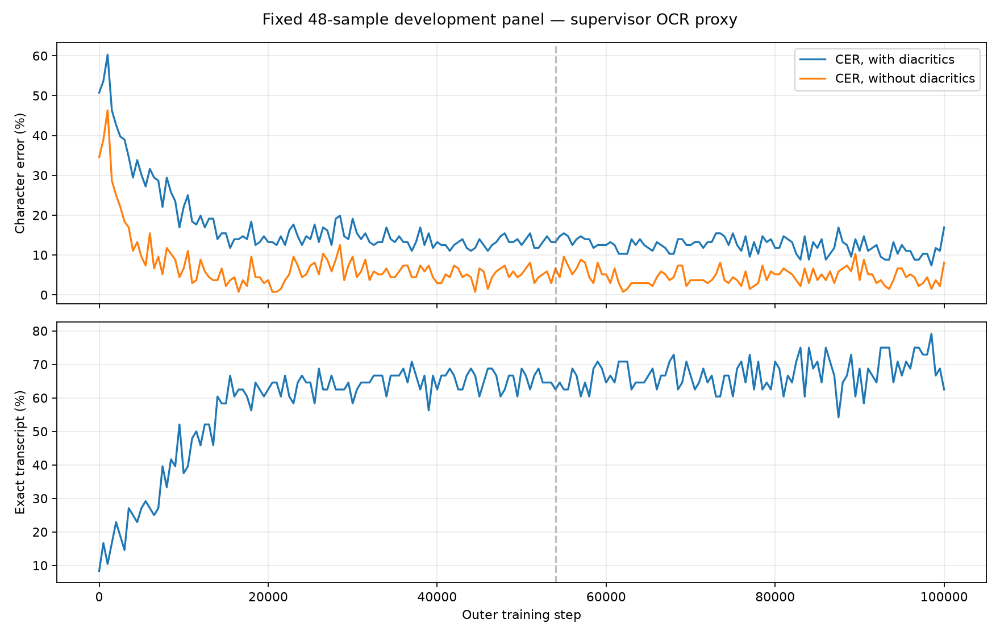
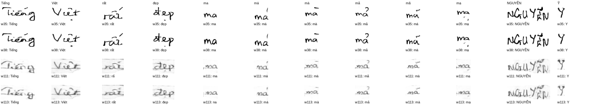
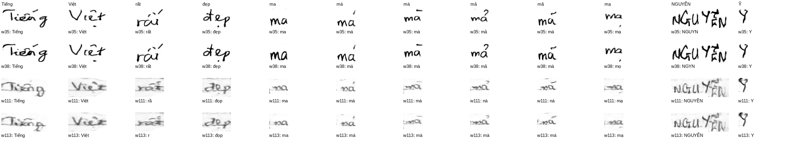
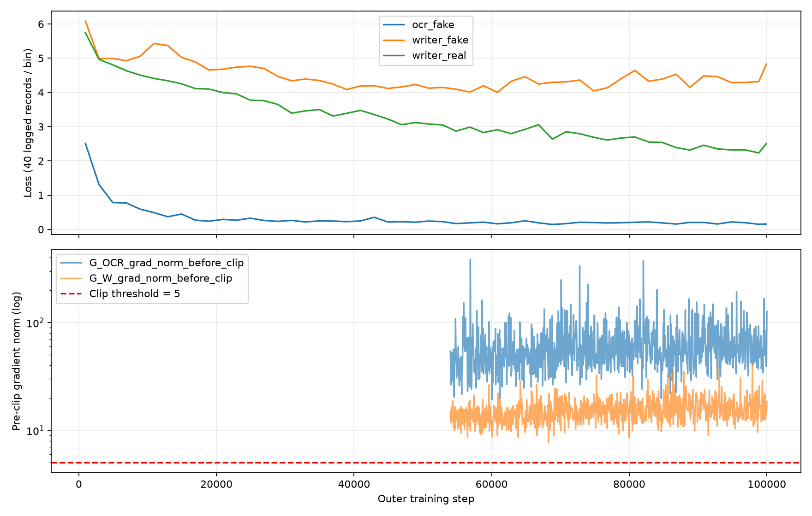

# Báo cáo kết quả fine-tuning VATr++ tiếng Việt — 100.000 steps

Fine-tuning đã hoàn thành tổng 100.000 outer steps. Model cải thiện rõ khả năng sinh nội dung tiếng Việt, nhưng chất lượng giữa các checkpoint còn dao động và khả năng giữ phong cách chưa được xác nhận bằng chỉ số độc lập.

CER nội bộ tốt nhất là **7,35% tại bước 98.500**; checkpoint cuối 100k có CER **16,91%**. Báo cáo này trình bày kết quả run đã hoàn tất; các cải tiến và thử nghiệm tiếp theo nằm trong [tài liệu triển khai riêng](261112_report_04_Cai_tien_va_tien_do_sau_100k.md).

## 1. Thiết lập fine-tuning 100k

| Hạng mục | Cấu hình |
| --- | --- |
| Model | VATr++ với generator pretrained, legacy style layout |
| Độ cao ảnh | 32 pixel |
| Dữ liệu writer thật dùng train | 97.734 mẫu, 265 writer |
| Development writer thật | 11.786 mẫu, 30 writer giữ riêng |
| HAT cho OCR/content | 102.533 mẫu; không dùng làm nhóm writer/style |
| OCR warmup | 20.000 steps; 200.267 mẫu train khả dụng |
| Batch / số support | 8 / 15 ảnh cùng writer |
| Seed | 742 |
| Learning rate encoder / G còn lại | 5e-6 / 2e-5 |
| Learning rate D / writer | 1e-5 / 2e-5 |
| OCR weight / writer weight | 4 / 0,1 trước gradient balancing |
| OCR trong GAN | Đóng băng tham số, eval mode |
| Sampling transcript | 35% HAT, 65% writer thật; rare_fraction = 0,3 |
| Gradient clipping | Global norm = 5 |
| Hardware | NVIDIA H200, PyTorch 2.9.1+cu128 |

Một outer step gồm 2 cập nhật G, 2 D và 1 writer classifier. OCR bị đóng băng trong run này. Mốc 100.000 là tổng các bước, bao gồm các lần resume.

Lần chạy tiếp từ checkpoint 54k đến 100k mất **15.451,49 giây, khoảng 4 giờ 18 phút**. Peak VRAM do allocator của tiến trình ghi nhận: allocated **3,20 GiB**, reserved **3,32 GiB**. Đây không phải tổng mức sử dụng GPU của mọi tiến trình trên máy.

Checkpoint cuối lưu thành công lúc **06:43:26 UTC ngày 12/11/2026**. Run đã kết thúc bình thường, không còn training 100k chạy nền.

## 2. Kết quả OCR warmup

Đánh giá trên toàn bộ **11.786 mẫu development ảnh thật**:

| Bước | CER ↓ | CER bỏ dấu ↓ | Tỷ lệ sai toàn từ ↓ |
| --- | --- | --- | --- |
| 1.000 | 53,43% | 50,13% | 89,47% |
| 5.000 | 25,13% | 20,73% | 54,39% |
| 10.000 | 18,86% | 15,04% | 43,73% |
| 15.000 | 17,72% | 14,36% | 41,07% |
| 20.000 | **16,19%** | **12,88%** | **38,52%** |

OCR đã học tiếng Việt nhưng còn sai số đáng kể. Khi dùng mạng này để giám sát G và chấm ảnh sinh, không thể quy mọi lỗi transcript thành lỗi sinh ảnh; cần đối chiếu trực quan hoặc OCR độc lập. CER trên ảnh thật và CER trên ảnh sinh là hai bài kiểm tra khác miền dữ liệu.

## 3. Chất lượng ảnh sinh đến 100k

Panel gốc gồm **12 prompt × 4 writer development = 48 mẫu**, tổng **136 ký tự tham chiếu**. CER là tổng edit distance ký tự chia tổng ký tự tham chiếu. Tỷ lệ đúng toàn từ là số transcript OCR khớp hoàn toàn chia số mẫu.

| Bước | CER ↓ | CER bỏ dấu ↓ | Đúng toàn từ ↑ | Số mẫu đúng |
| --- | --- | --- | --- | --- |
| 0 | 50,74% | 34,56% | 8,33% | 4/48 |
| 10.000 | 22,06% | 6,62% | 37,50% | 18/48 |
| 20.000 | 13,24% | 3,68% | 62,50% | 30/48 |
| 30.000 | 19,12% | 9,56% | 58,33% | 28/48 |
| 41.500 | 11,03% | 4,41% | 68,75% | 33/48 |
| 50.000 | 12,50% | 5,15% | 68,75% | 33/48 |
| 90.000 | 11,03% | 3,68% | 68,75% | 33/48 |
| **98.500** | **7,35%** | **1,47%** | **79,17%** | **38/48** |
| 100.000 | 16,91% | 8,09% | 62,50% | 30/48 |

### Diễn biến theo giai đoạn

| Khoảng steps | CER trung bình | Đúng toàn từ trung bình |
| --- | --- | --- |
| 50–60k | 13,48% | 65,38% |
| 60–70k | 12,18% | 66,87% |
| 70–80k | 13,13% | 65,67% |
| 80–90k | 12,15% | 67,46% |
| 90–100k | **11,03%** | **69,84%** |

Mỗi khoảng gồm 21 lần đánh giá, bao gồm hai đầu; mốc biên trùng giữa hai khoảng liền kề. Đây là trung bình checkpoint trên cùng panel, không phải nhiều mẫu độc lập hay nhiều seed.

Độ lệch chuẩn CER theo checkpoint tăng từ khoảng **1,16 điểm phần trăm** ở 50–60k lên **2,13 điểm** ở 90–100k. Model có khả năng đạt kết quả tốt hơn nhưng chưa duy trì ổn định ở mọi mốc.

### Sample tốt nhất đã ghi: 98.500 steps

### Sample checkpoint cuối: 100.000 steps

Chữ thường như “Tiếng”, “Việt”, “rất”, “đẹp” đã đọc được ở nhiều mẫu. Các nhóm khó còn gồm dấu ngã, chữ hoa có dấu và ký tự hiếm `Ỹ`. Một số nét chữ giữa các writer cùng nguồn khá giống nhau; chưa có thước đo style độc lập để định lượng.

Ví dụ transcript OCR:

| Writer | Yêu cầu | @98.500 | @100.000 |
| --- | --- | --- | --- |
| 35 | NGUYỄN | NGUYỄN | NGUYN |
| 38 | NGUYỄN | NGUYỄN | NGYN |

Đây là dự đoán của OCR trên ảnh sinh, không phải kết quả chấm bằng người đọc.

Run cũ chỉ giữ `last.pth`; **không còn trọng số 98.500 riêng để phục hồi**. Sample và chỉ số tại mốc này vẫn còn.

## 4. Phân tích loss và vấn đề cần cải tiến

| Loss trung bình | 10–15k | 45–50k | 95–100k |
| --- | --- | --- | --- |
| OCR fake | 0,4338 | 0,2296 | **0,1914** |
| Writer fake | 5,3473 | **4,1578** | 4,2975 |
| Writer real | 4,3455 | 3,1347 | **2,3160** |
| D pha OCR | 1,9176 | 1,2724 | 1,0498 |
| D pha writer | 1,8507 | 1,0924 | 0,8098 |

Các số là trung bình batch được log, không phải đánh giá loss toàn bộ dữ liệu trên cùng batch cố định.

- **Nội dung vẫn học thêm:** OCR fake loss giảm khoảng 16,6% từ 45–50k đến 95–100k.
- **Nhánh phong cách chững:** writer classifier học ảnh thật tốt hơn nhưng writer loss trên ảnh sinh tăng nhẹ. Chưa có bằng chứng G truyền phong cách tốt hơn tương ứng.
- **D loss giảm không tự chứng minh ảnh tốt hơn:** có thể liên quan khả năng phân biệt thật/giả tăng lên; đã bổ sung điểm D(real)/D(fake) để quan sát rõ hơn.
- **Loss G tổng không đơn điệu:** tổng adversarial và auxiliary có trọng số thay đổi theo gradient balancing, không có mục tiêu đơn giản là giảm về 0.

Trong **921 mốc log sau resume**, norm gradient trước clip vượt 5 ở cả hai pha G:

| Pha | Norm trung bình | Lớn nhất | Tỷ lệ mốc norm > 5 |
| --- | --- | --- | --- |
| G + OCR | 61,58 | 385,11 | 100% |
| G + writer | 15,40 | 40,51 | 100% |

Clipping kéo dài đã được quan sát, nhưng chưa chứng minh là nguyên nhân chính của plateau. Không tự tăng ngưỡng clip vì có thể làm training dao động hơn. Với Adam, không thể suy ra tốc độ cập nhật tham số giảm cùng tỷ lệ với norm bị clip.

Legacy style layout là một điểm nghi vấn riêng từ mã nguồn: cách `view` feature chưa hoán vị trục support/channel. Cần kiểm tra thứ tự tensor và ablation riêng; chưa sửa kiến trúc giữa run đang so sánh.

## 5. Artifact và tài liệu liên quan

- [Báo cáo số liệu chi tiết, lỗi theo writer và sample bổ sung](training_report_100k/261112_report_02_Chi_tiet_training_100k.md).
- [CSV benchmark 0–100k](training_report_100k/benchmark_metrics.csv).
- Checkpoint cuối: `runs/vatrpp_vn_finetune_100k/last.pth`.
- Nguồn số liệu: metrics, benchmark JSON, config và profile trong `runs/vatrpp_vn_finetune_100k/`, cùng lịch sử `runs/vatrpp_vn_finetune/` và OCR warmup `runs/vatrpp_vn_ocr_train/`.
- [Các cải tiến và tiến độ triển khai sau 100k](261112_report_04_Cai_tien_va_tien_do_sau_100k.md).
