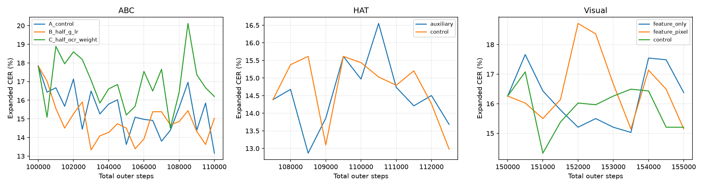
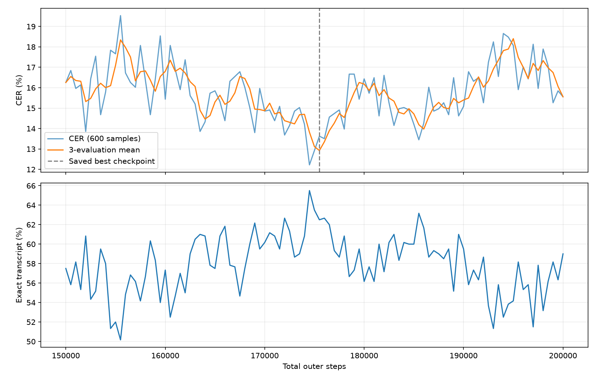
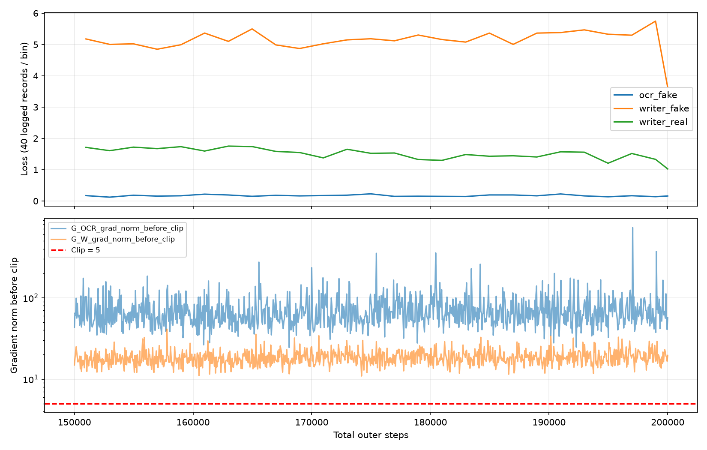
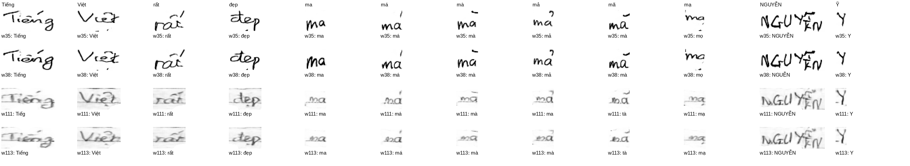
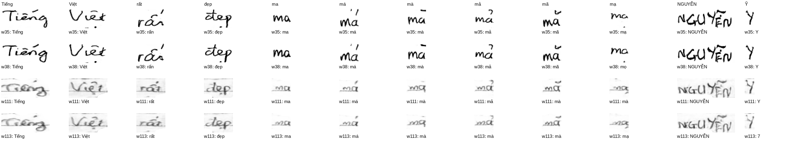
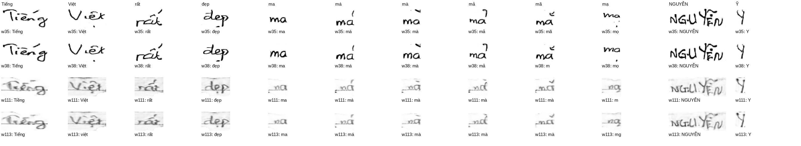

# Báo cáo tổng hợp triển khai và kết quả cải tiến VATr++ tiếng Việt đến 200.000 steps

Chốt số liệu: 14/11/2026 06:33 UTC. Nguồn: log, config, benchmark JSON và checkpoint metadata trong workspace. Báo cáo ghi kết quả thực tế, không coi thay đổi code là bằng chứng chất lượng tăng.

## 1. Kết luận điều hành

**Run baseline đã hoàn thành 200.000 steps. Các hạ tầng theo dõi/lưu model đã cải thiện, nhưng chưa có thử nghiệm loss mới nào chứng minh tăng chất lượng tổng thể ổn định so với đối chứng.**

- Training thêm từ 150k có giai đoạn tốt ở khoảng 170–180k, sau đó dao động và suy giảm trung bình ở 190–200k.
- CER cuối 200k tốt hơn nhẹ so với 150k, nhưng trung bình 5 mốc cuối không tốt hơn baseline.
- Giảm LR G, giảm OCR weight, self-reconstruction HAT và paired feature/pixel loss đều đã chạy đối chứng; chưa có cấu hình mới đủ cơ sở để thay baseline.
- Các chữ hoa hiếm `Ê`, `Ắ`, `Ễ`, `Ỡ` thiếu ảnh train của writer thật. HAT có dữ liệu nhưng pipeline baseline không dùng ảnh HAT giám sát trực tiếp G/style.
- OCR đọc đúng không bảo đảm chữ đẹp. Chưa có OCR độc lập, style evaluator độc lập hoặc đánh giá người đọc có hệ thống.

## 2. Phạm vi và quan hệ giữa các run

Các nhánh không tạo thành một lịch train nối tiếp duy nhất. Nguồn và ngân sách thực tế:

| Run | Nguồn | Đích | Mục đích |
| --- | --- | --- | --- |
| A/B/C | 100k | 110k, mỗi nhánh +10k | So LR và OCR weight |
| Continuation 150k | Best A ở 107,5k | 150k | Tiếp tục baseline đủ điều kiện proxy |
| Pilot HAT Ễ | Best A ở 107,5k | 112,5k, mỗi nhánh +5k | Kiểm tra self-reconstruction |
| Pilot visual | Baseline cuối 150k | 155k, mỗi nhánh +5k | Feature matching và pixel loss |
| Continuation 200k | Baseline cuối 150k | 200k, thêm 50k | Giữ cấu hình baseline, theo yêu cầu |

Trọng số pilot HAT và visual không được gộp vào run 200k. Kết quả một nhánh không được xem là cải thiện của baseline nếu chưa vượt đối chứng cùng nguồn.

## 3. Những phần đã triển khai

| Hạng mục | Thay đổi cụ thể | Kết quả/giới hạn |
| --- | --- | --- |
| Resume LR | Áp dụng LR CLI sau nạp optimizer; tách writer LR | Giữ Adam moments, tránh giảm nhầm LR writer |
| Checkpoint | last, best OCR, best focus, 3 checkpoint gần nhất | Tránh mất toàn bộ trọng số tốt như run 100k; vẫn không giữ mọi bước |
| Chọn best OCR | CER trung bình 3 lần đánh giá | Ít nhạy với một mốc; chưa đại diện thẩm mỹ |
| Panel expanded | 20 prompt × 30 writer development = 600 mẫu | Bao phủ writer/chữ hoa hơn panel gốc 48 mẫu |
| Chỉ số theo nhóm | Uppercase/other, từng writer, từng prompt | Tách nhóm lỗi khỏi CER tổng |
| Debug | D(real)/D(fake), gradient std theo loss, effective weights, norm trước clip | Giúp phát hiện clipping và cân bằng mục tiêu |
| RNG | Benchmark cố định bảo toàn RNG/mode G | Giảm tác động của evaluation lên chuỗi training |
| Queue | A/B/C và các pilot tuần tự, có status/exit code | Dừng nếu có lỗi; lưu rõ nguồn/cấu hình |
| HAT auxiliary | Self-reconstruction ảnh chứa Ễ; không giám sát pseudo writer | Chạy được; chưa tăng chất lượng tổng thể |
| Visual auxiliary | Ảnh thật cùng transcript/writer; feature loss, L1 nhẹ | Chạy được; chưa thắng đối chứng rõ ràng |
| Visual evaluator | 60 target của 30 writer; D nguồn cố định | Proxy đặc trưng, không phải điểm đẹp độc lập |
| Best visual | Giữ model feature distance tốt với gate CER +2 điểm | Không tự động promote |
| Sửa lỗi OCR fallback | Chụp OCR sau resume khi chưa có benchmark_ocr.pth | Khắc phục chấm nhầm bằng OCR ngẫu nhiên trong smoke v1 |

Các run chính và pilot cũ đã copy sẵn OCR benchmark nên không đi qua lỗi fallback. Smoke visual v1 không dùng để đánh giá chất lượng; smoke v2 xác nhận OCR khớp nguồn. Bộ kiểm thử tăng từ 4 lên **10 test pass** ở lần triển khai visual, bao gồm mask padding, gradient, tách transcript và support không chứa target. Chưa chạy lại toàn bộ test chỉ để tạo báo cáo này.

## 4. Thử nghiệm A/B/C sau 100k

| Nhánh | Thay đổi | CER cuối | Exact cuối |
| --- | --- | --- | --- |
| A_control | Giữ baseline | 13,16% | 62,67% |
| B_half_g_lr | LR G giảm 1/2; LR writer giữ nguyên | 15,03% | 58,83% |
| C_half_ocr_weight | OCR weight 4 → 2 | 16,20% | 55,83% |

Ở checkpoint cuối, A tốt nhất; B có cửa sổ CER tốt nhất nhỉnh hơn A ở một thời điểm, nhưng không đủ để chọn B theo tiêu chí ổn định cuối run. Hệ thống đã chọn best A ở 107.500 để tiếp tục đến 150k. Không kết luận LR thấp hơn hoặc OCR weight thấp hơn luôn kém: đây là một seed và ngân sách 10k steps.

## 5. Pilot bổ sung ảnh HAT cho chữ Ễ

Dữ liệu: 100 ảnh HAT chứa `Ễ`; chia theo transcript thành **69 train / 31 theo dõi**. HAT không có metadata nhóm writer thật. Auxiliary dùng target làm reference đơn, lặp support theo shape kiến trúc rồi tái tạo; chỉ cập nhật G, weight 0,2 mỗi 4 outer steps, batch 2. Tập 31 ảnh chỉ giữ riêng khỏi auxiliary mới, không độc lập với OCR warmup/corpus trước đó.

| Nhánh @112,5k | CER 600 mẫu | Exact tổng | NGUYỄN exact | Ễ riêng exact |
| --- | --- | --- | --- | --- |
| auxiliary | 13,68% | 61,50% | 63,33% | 0,00% |
| control | 12,98% | 63,50% | 53,33% | 0,00% |

Kết quả: tăng nhận dạng `NGUYỄN` ở mốc cuối nhưng tổng thể kém control; `Ễ` riêng vẫn 0/30. Tự tái tạo có thể học lối tắt sao chép reference, không chứng minh chuyển chữ sang style mới. Không gộp auxiliary HAT vào baseline.

## 6. Pilot feature matching và pixel loss sau 150k

Ba nhánh 150k→155k giữ LR/OCR/writer/clip baseline. Feature-only weight 1; feature+pixel weight 1 và 0,1. Auxiliary mỗi 4 outer steps, sinh transcript của target thật bằng support cùng writer khác target. D frozen/eval khi trích feature; target feature detach, padding được mask.

| Nhánh @155k | CER 600 ↓ | Exact 600 ↑ | Feature distance 60 ↓ | Pixel L1 60 ↓ | CER 60 ↓ |
| --- | --- | --- | --- | --- | --- |
| feature_only | 16,37% | 56,17% | 0,3063 | 0,2644 | 3,30% |
| feature_pixel | 15,15% | 57,67% | 0,3081 | 0,2664 | 3,77% |
| control | 15,20% | 59,50% | 0,3053 | 0,2634 | 4,25% |

Nhánh feature+pixel giảm CER tổng so control chỉ khoảng **0,06 điểm phần trăm**, trong khi exact thấp hơn **1,83 điểm** và feature/pixel distances đều cao hơn. Feature-only nhận dạng tốt hơn trên panel 60 target nhưng kém trên panel 600 prompt. Không có bằng chứng lợi ích tổng thể ổn định.

D evaluator được chụp từ nguồn 150k, giữ cố định giữa các nhánh, tránh dùng D đang thay đổi để xếp hạng. Tuy nhiên, nó có chung lịch sử training với generator và chưa được hiệu chỉnh theo đánh giá người đọc. L1 thấp cũng có thể ưu tiên ảnh nhòe; không đồng nhất với chữ đẹp.

Nhánh auxiliary HAT và visual có thêm cập nhật G; cùng số outer steps không đồng nghĩa cùng số update hoặc compute. Cần đối chứng cùng ngân sách cập nhật nếu muốn kết luận nguyên nhân chặt chẽ.

### So sánh đầy đủ diễn biến các thử nghiệm

| Nhóm | Nhánh | Bước cuối | CER cuối | Exact cuối | CER TB sau baseline | CER TB 5 mốc cuối |
| --- | --- | --- | --- | --- | --- | --- |
| ABC | A_control | 110000 | 13,16% | 62,67% | 15,33% | 15,19% |
| ABC | B_half_g_lr | 110000 | 15,03% | 58,83% | 14,76% | 14,65% |
| ABC | C_half_ocr_weight | 110000 | 16,20% | 55,83% | 16,95% | 17,36% |
| HAT | auxiliary | 112500 | 13,68% | 61,50% | 14,57% | 14,74% |
| HAT | control | 112500 | 12,98% | 63,50% | 14,74% | 14,46% |
| Visual | feature_only | 155000 | 16,37% | 56,17% | 16,22% | 16,33% |
| Visual | feature_pixel | 155000 | 15,15% | 57,67% | 16,53% | 16,12% |
| Visual | control | 155000 | 15,20% | 59,50% | 15,84% | 15,92% |

Trung bình theo các lần đánh giá trên cùng panel, không phải thêm mẫu độc lập; các hàng thuộc nguồn khác nhau không dùng để suy ra một nhánh vượt nguồn khác.

## 7. Run chính 150k → 200k

| Thông số | Giá trị |
| --- | --- |
| Trạng thái | Completed, exit code 0 |
| Bắt đầu UTC | 2026-11-13T13:39:20.375518+00:00 |
| Kết thúc UTC | 2026-11-13T20:02:14.828644+00:00 |
| Thời gian training/profile | 6.37 giờ |
| Outer steps thêm | 50.000 |
| Batch/support | 8 / 15 |
| LR encoder / G / D / writer | 5e-6 / 2e-5 / 1e-5 / 2e-5 |
| OCR/writer weight | 4 / 0,1; gradient balancing bật |
| OCR | Frozen, eval mode |
| Kiến trúc | Legacy layout; không thay kiến trúc |
| HAT/feature/pixel auxiliary | Đều tắt |
| Lưu/đánh giá/log | 500 / 500 / 50 steps |
| Runtime | H200, 2.9.1+cu128 |
| Peak allocated/reserved | 3.21 / 3.38 GiB |

Peak VRAM là số đo allocator của riêng run, không phải tổng GPU của mọi người dùng. Quyền truy cập từng làm trì hoãn khởi chạy, không tính vào thời gian training/profile.

### Benchmark 600 mẫu theo mốc

| Mốc | CER | CER bỏ dấu | Exact |
| --- | --- | --- | --- |
| 150k baseline | 16,26% | 11,23% | 57,50% |
| 174,5k tốt nhất một lần | 12,22% | 9,30% | 65,50% |
| 175,5k best.pth đã giữ | 13,63% | 9,30% | 62,50% |
| 200k cuối | 15,56% | 11,11% | 59,00% |

CER cuối giảm **0.70 điểm phần trăm** so 150k; exact tăng **1.50 điểm**. Nhưng CER trung bình 5 mốc cuối là **16,33%**, chưa tốt hơn baseline một mốc ở 150k. Không xem checkpoint cuối là bằng chứng cải thiện bền vững.

### Diễn biến theo từng khoảng 10k

| Khoảng | Số đánh giá | CER trung bình | Exact trung bình |
| --- | --- | --- | --- |
| 150–160k | 21 | 16,53% | 56,04% |
| 160–170k | 21 | 15,68% | 58,35% |
| 170–180k | 21 | 14,61% | 60,42% |
| 180–190k | 21 | 15,15% | 59,16% |
| 190–200k | 21 | 16,78% | 55,74% |

Các khoảng gồm hai đầu, nên mốc biên được tính trong hai khoảng liền kề. Giai đoạn 170–180k tốt nhất về trung bình; 190–200k suy giảm. Điều này phù hợp với training còn dao động/chững; chưa đủ bằng chứng để gọi là overfitting hay mode collapse.

### Loss và gradient

| Khoảng | OCR fake | Writer fake | Writer real | Norm G OCR | Norm G writer |
| --- | --- | --- | --- | --- | --- |
| 150–160k | 0,1607 | 5,0042 | 1,6870 | 68,2639 | 17,9241 |
| 160–170k | 0,1800 | 5,1646 | 1,6426 | 67,1556 | 18,1919 |
| 170–180k | 0,1770 | 5,1569 | 1,4865 | 73,5214 | 18,9375 |
| 180–190k | 0,1686 | 5,1989 | 1,4175 | 74,6922 | 18,5607 |
| 190–200k | 0,1652 | 5,4350 | 1,4348 | 75,2055 | 19,3378 |

OCR fake không giảm đơn điệu. Writer real giảm rõ hơn writer fake; bộ phân loại writer học ảnh thật tốt hơn nhưng generator chưa giữ phong cách tương ứng. D loss hay loss tổng G không phải thước đo thẩm mỹ.

| Pha | Norm TB | Norm max | Tỷ lệ mốc norm > 5 |
| --- | --- | --- | --- |
| G_OCR_grad_norm_before_clip | 71,6395 | 730,9057 | 100,00% |
| G_W_grad_norm_before_clip | 18,5849 | 41,1692 | 100,00% |

Đã kiểm tra 1001 bản ghi loss; số bản ghi có scalar NaN/Inf: 0. Clipping thường xuyên đã xác nhận ở mốc log, không phải đo mọi update. Không suy ra tốc độ cập nhật Adam giảm đúng tỷ lệ norm bị clip.

### Nhóm lỗi và chữ hoa hiếm

| Prompt | Exact 150k | Exact 200k | CER 200k |
| --- | --- | --- | --- |
| Tiếng | 83,33% | 60,00% | 11,33% |
| Việt | 96,67% | 93,33% | 1,67% |
| mả | 26,67% | 43,33% | 31,67% |
| mã | 0,00% | 23,33% | 45,00% |
| mạ | 23,33% | 26,67% | 38,33% |
| NGUYỄN | 76,67% | 80,00% | 3,33% |
| Ỹ | 0,00% | 0,00% | 100,00% |
| Ắ | 0,00% | 0,00% | 126,67% |
| Ễ | 0,00% | 0,00% | 100,00% |
| Ỡ | 0,00% | 0,00% | 100,00% |
| Ự | 0,00% | 0,00% | 100,00% |

CER có thể >100% khi OCR chèn nhiều ký tự so với nhãn một ký tự. Dữ liệu sau lọc: writer thật không có `Ê`, `Ắ`, `Ễ`, `Ỡ`; HAT có lần lượt 961, 334, 100, 103 ảnh chứa ký tự. `Tà` có 34 ảnh writer thật chứa tổ hợp trong Tàu/Tài nhưng không có target đúng nguyên từ Tà. Không phải mọi chữ xấu đều do thiếu ký tự; còn lỗi tối ưu, chuyển style và giới hạn OCR.

## 8. Sample và kiểm tra thị giác

Cùng panel gốc 48 mẫu, 4 writer, OCR và support cố định. Chỉ số panel này không so trực tiếp với CER 600 mẫu.

### Baseline 150k

### Checkpoint được giữ best.pth: 175.500

### Checkpoint cuối 200k

[Sample mốc 174.500 có CER 600 mẫu thấp nhất](report_200k_assets/sample_174500.png). [Panel đầy đủ 600 mẫu ở 200k](../runs/continuation_200k_v1/expanded/benchmark_200000.png). Chưa có chấm mù bằng người đọc, vì vậy không khẳng định ảnh ở mốc CER tốt nhất là đẹp nhất.

## 9. Inference chữ hoa theo yêu cầu người dùng

Tám từ: DƯƠNG, HƯỜNG, HƯƠNG, ĐƯỜNG, TRƯỜNG, NGUYỄN, THƯỜNG, HOÀNG; 4 writer dùng cùng 15 support. Kết quả dưới đây thuộc lần inference 150k/155k, **chưa chạy lại với 175,5k hoặc 200k**.

| Checkpoint | DƯƠNG đúng OCR | HƯỜNG đúng OCR | Tổng đúng |
| --- | --- | --- | --- |
| baseline_150k | 4/4 | 4/4 | 31/32 |
| control_155k | 3/4 | 2/4 | 20/32 |
| feature_only_155k | 2/4 | 3/4 | 17/32 |
| feature_pixel_155k | 2/4 | 1/4 | 17/32 |

Inference dùng PyTorch 2.14.0+cu130 vì interpreter cũ tạm mất quyền, khác runtime train 2.9.1+cu128; bốn model dùng cùng runtime inference. Đã đối chiếu 4 transcript NGUYỄN của baseline với artifact train: khớp cả 4, nhưng đây không chứng minh tương đương mọi đầu ra giữa runtime. Bộ 32 mẫu nhỏ chọn theo yêu cầu không phải benchmark chữ hoa tổng quát.

## 10. Đánh giá tác động thực tế và phần chưa làm

| Hạng mục | Đánh giá hiện tại |
| --- | --- |
| Hạ tầng lưu model/log/evaluation | Có lợi ích vận hành đã xác nhận: truy được nguồn, giữ best và phân tích lỗi |
| A/B/C | Chưa chứng minh thay LR/OCR weight thắng baseline ổn định |
| HAT self-reconstruction | Chưa giải quyết Ễ hoặc cải thiện tổng thể |
| Paired feature/pixel | Chưa thắng đối chứng về tổng thể; chưa xác nhận đẹp hơn bằng người đọc |
| Training đến 200k | Có đỉnh tốt trung gian; cải thiện cuối nhỏ, cuối run trung bình không tốt hơn baseline |
| Chữ hoa thường gặp | Sinh được một số từ; chất lượng khác nhau theo checkpoint/writer |
| Chữ hoa hiếm đứng riêng | Vẫn thất bại trên OCR nội bộ; thiếu giám sát ảnh writer thật |
| OCR độc lập / HWD / chấm người đọc | Chưa triển khai; không báo cáo như kết quả đã có |
| Sửa legacy style layout / positional encoding | Chưa đưa vào các run trên |
| Thêm dữ liệu writer thật có chữ hiếm | Chưa có nguồn dữ liệu mới được bổ sung |

## 11. Đề xuất sử dụng checkpoint và hướng tiếp theo

1. Giữ `continuation_200k_v1/best.pth` ở **175.500** làm ứng viên theo CER ổn định 3 mốc, cùng baseline 150k và last 200k để so sample. Best rolling mean 12,92% là trung bình các model liên tiếp, không phải CER của riêng trọng số 175.500; CER riêng model đó là 13,63%.
2. Không mặc định train tiếp cùng cấu hình. Đánh giá mù cùng prompt/support giữa 150k, 175,5k và 200k; xem nét/dấu/khoảng cách và mức giống writer.
3. Bổ sung ảnh chữ hoa hiếm của các writer có nhiều reference. Sampling lại transcript không thay thế được ảnh giám sát còn thiếu.
4. Thêm evaluator OCR/style độc lập trước khi dùng CER làm gate chạy dài; metric từ D cố định chỉ là proxy bổ trợ.
5. Nếu tiếp tục thay loss hoặc layout, chạy ablation một yếu tố, nhiều seed và đối chứng ngân sách cập nhật; ghi rõ không cùng compute khi thêm G update.

Không có run training mới được khởi chạy để tạo báo cáo này. Các thử nghiệm và continuation nêu trên đều đã hoàn thành.

## 12. Artifact và khả năng kiểm tra lại

- [CSV benchmark đầy đủ 150k→200k](report_200k_assets/benchmark_150k_200k.csv).
- [CSV tổng hợp các nhánh](report_200k_assets/experiment_summary.csv).
- [Trạng thái kết thúc run 200k](../runs/continuation_200k_v1/status.json).
- [Log run 200k](../runs/continuation_200k_v1/train.log).
- [Best selection 200k](../runs/continuation_200k_v1/best_selection.json).
- [So sánh A/B/C](../runs/ablation_100k_v1/comparison.json).
- [So sánh HAT](../runs/rare_hat_Ễ_pilot_v1/comparison.json).
- [So sánh visual](../runs/visual_quality_pilot_v1/comparison.json).
- [Inference chữ hoa](../runs/uppercase_comparison_v1/REPORT_VI.md).
- [Audit ký tự hiếm](audit_Ta_E_O_A.json).
- [Báo cáo kết quả 100k riêng](261112_report_03_Ket_qua_finetune_100k.md).
- [Thiết kế OCR đúng/chữ xấu và visual loss](261112_report_07_OCR_dung_nhung_chu_xau_va_cai_tien.md).

Các bảng lấy trực tiếp từ JSON/log, biểu đồ được dựng từ toàn bộ mốc đã lưu. Các kết luận nhân quả chưa được xác nhận được ghi rõ là giả thuyết/giới hạn, không thay bằng cam kết cải thiện.

### Các file code triển khai chính

- [Trainer và các cờ thử nghiệm](../train_vietnamese.py).
- [Benchmark OCR/prompt cố định](../util/vietnamese_benchmark.py).
- [HAT auxiliary](../data/vietnamese_rare_content.py).
- [Visual loss và panel ảnh thật/ảnh sinh/support](../util/vietnamese_visual.py).
- [Queue A/B/C](../scripts/run_vietnamese_ablations.py).
- [Queue HAT](../scripts/run_rare_hat_content_pilot.py).
- [Queue visual](../scripts/run_visual_quality_pilot.py).
- [Launcher 200k](../scripts/resume_vietnamese_200k.py).
- [Inference chữ hoa](../scripts/infer_uppercase_comparison.py).
