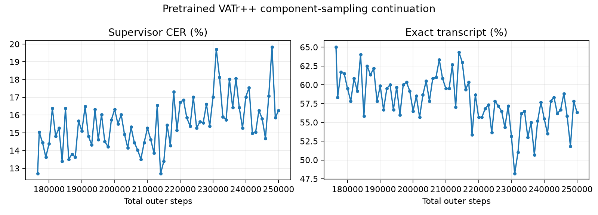

# Tiếp tục component sampling đến 250.000 steps

Trạng thái: **completed**. Nguồn **176,500**, mục tiêu **250,000** tổng outer steps. Benchmark mới nhất đã hoàn thành: **250,000**.

Fine-tune native VATr++ với component-aware transcript sampling. Giữ nguyên kiến trúc, G/D/writer/OCR, Adam và LR từ nguồn; batch/support 8/15, OCR frozen, không thêm auxiliary loss.

| Mốc | CER ↓ | CER bỏ dấu ↓ | Exact ↑ |
|---|---:|---:|---:|
| Nguồn 176500 | 12.69% | 8.65% | 65.00% |
| Mới nhất 250000 | 16.26% | 10.58% | 56.33% |

| Prompt | Exact nguồn | Exact mới nhất | CER mới nhất |
|---|---:|---:|---:|
| Tiếng | 24/30 | 17/30 | 9.33% |
| Việt | 30/30 | 30/30 | 0.00% |
| mã | 11/30 | 7/30 | 45.00% |
| mạ | 12/30 | 13/30 | 28.33% |
| NGUYỄN | 29/30 | 5/30 | 18.89% |
| Ắ | 0/30 | 0/30 | 100.00% |
| Ễ | 0/30 | 0/30 | 100.00% |
| Ỡ | 0/30 | 0/30 | 100.00% |
| Ự | 0/30 | 0/30 | 100.00% |

Panel cố định 600 mẫu / 30 writer. Đây là OCR supervisor proxy, không phải điểm đẹp hay đánh giá style độc lập. Không suy ra lợi ích bền vững từ một mốc; rolling mean dùng để chọn một checkpoint hiện tại, không phải trung bình trọng số.

Best đang giữ: bước 188000, CER riêng 13.63%, rolling CER 13.65% trên cửa sổ 3 mốc.

[Panel nguồn](component_250k_assets/benchmark_176500.png) · [Panel mới nhất](component_250k_assets/benchmark_250000.png)

- Trạng thái: `/home/bachdx2/DraftAnything/hand_writting/VATr-pp/runs/component_continuation_250k_v1/status.json`.
- Log: `/home/bachdx2/DraftAnything/hand_writting/VATr-pp/runs/component_continuation_250k_v1/train.log`.
- Checkpoint: `/home/bachdx2/DraftAnything/hand_writting/VATr-pp/runs/component_continuation_250k_v1/last.pth`, `best.pth`, `best_focus.pth` và 3 checkpoint định kỳ gần nhất.
- Checkpoint/evaluation mỗi 1.000 steps; log mỗi 50 steps. Không tự thay thế checkpoint nguồn.
