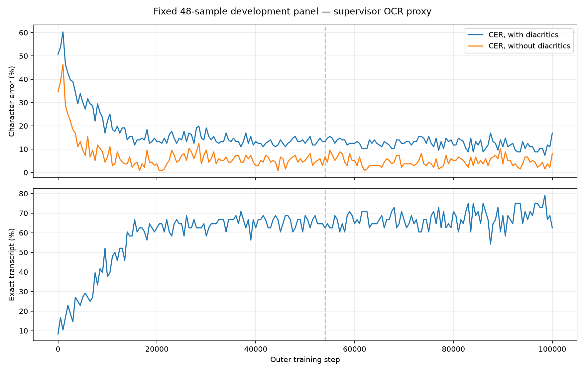
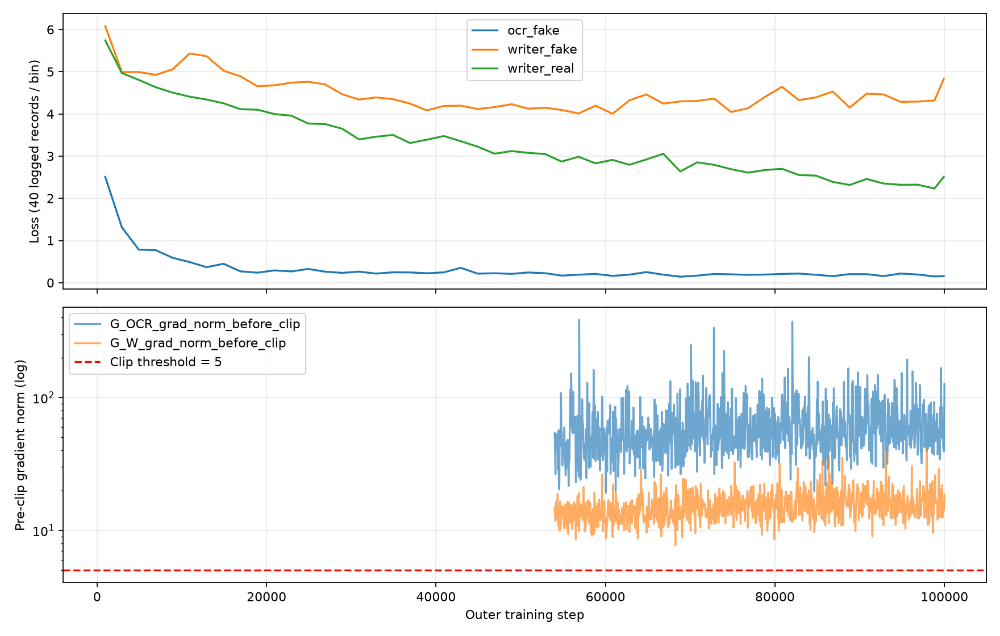
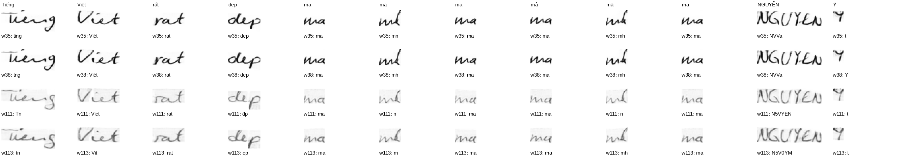
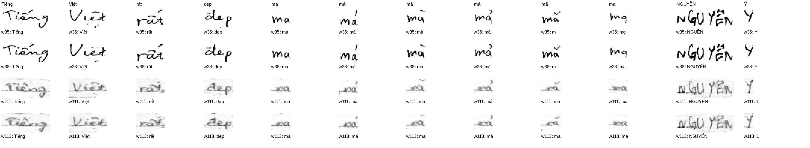
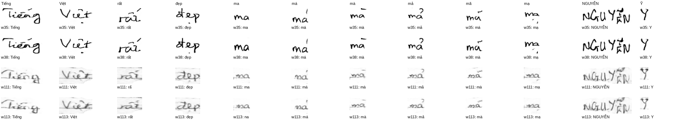
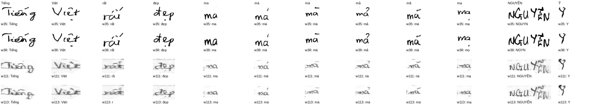
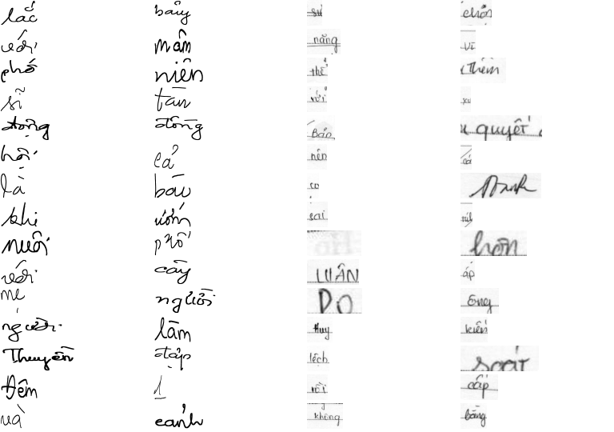

# Báo cáo training VATr++ tiếng Việt — 100.000 steps

## 1. Kết quả chính

**Đã hoàn thành 100.000 outer steps.** Checkpoint cuối lưu lúc 06:43:26 UTC ngày 12/11/2026. Lần resume từ 54.000 đến 100.000 mất 4.29 giờ. Đây là một run, một seed; chưa có độ lệch chuẩn giữa nhiều seed.

Model cải thiện trung bình khi train tiếp, nhưng chất lượng dao động và checkpoint cuối không phải mốc có benchmark tốt nhất. Mốc 98.500 có CER proxy thấp nhất toàn bộ lịch sử đã ghi. Chỉ còn checkpoint cuối `last.pth`; mốc 98.500 giữ ảnh/JSON, không giữ riêng trọng số để tái sử dụng.

## 2. Cấu hình và dữ liệu

| Thành phần | Giá trị |
| --- | --- |
| Kiến trúc | VATr++ pretrained, legacy style layout; ảnh cao 32 px |
| Seed | 742 |
| Batch / support | 8 / 15 ảnh cùng writer |
| Train writer thật | 97.734 mẫu, 265 writer |
| Development | 11.786 mẫu, 30 writer giữ riêng |
| HAT OCR | 102.533 mẫu; không dùng writer/style supervision |
| OCR warmup | 20.000 steps; 200.267 mẫu khả dụng, sampling theo nguồn |
| GAN corpus | 35% HAT, 65% writer thật; rare_fraction=0,3 |
| OCR trong GAN | Đóng băng tham số và eval mode |
| Learning rate G encoder / G còn lại | 5e-6 / 2e-5 |
| Learning rate D / writer | 1e-5 / 2e-5 |
| OCR weight / writer weight | 4 / 0,1 trước gradient balancing |
| Gradient clipping | global norm tối đa 5 |
| Lưu / benchmark | Mỗi 500 outer steps |
| GPU / PyTorch | H200 / 2.9.1+cu128 |
| VRAM peak allocated / reserved | 3.20 / 3.32 GiB (riêng allocator của run) |

Mỗi outer step có 2 cập nhật G, 2 D, 1 writer. OCR bị freeze nên không có cập nhật OCR trong run GAN này. `100.000 steps` là tổng bước gồm các lần resume, không phải 100.000 bước bổ sung.

## 3. Định nghĩa và giới hạn các số đo

- CER = tổng edit distance ký tự / tổng ký tự tham chiếu; thấp hơn tốt hơn.
- CER bỏ dấu: chuẩn hóa NFD, bỏ dấu kết hợp và đổi đ/Đ thành d/D trước khi tính. Chênh lệch hai CER không phải một phép phân rã lỗi dấu chính xác.
- Đúng toàn từ: tỷ lệ transcript OCR khớp hoàn toàn nhãn; cao hơn tốt hơn.
- Panel gồm 12 prompt × 4 writer development (35, 38, 111, 113), tổng 48 mẫu và 136 ký tự tham chiếu. Một lỗi ký tự thay đổi CER khoảng 0,735 điểm phần trăm; một từ thay đổi exact rate khoảng 2,083 điểm.
- OCR chấm ảnh sinh cũng là OCR dùng giám sát nội dung. Đây là **proxy nội bộ**, có thể bị model khai thác; chưa thay thế OCR độc lập, đánh giá người đọc hoặc đo phong cách. Panel lặp trong suốt training không phải tập test cuối độc lập.
- CER warmup đo trên ảnh thật khác miền ảnh sinh: không so trực tiếp hai tập như cùng một bài kiểm tra.

## 4. OCR warmup trên 11.786 mẫu development

| Bước | CER | CER bỏ dấu | Tỷ lệ sai toàn từ |
| --- | --- | --- | --- |
| 1000 | 53.43% | 50.13% | 89.47% |
| 5000 | 25.13% | 20.73% | 54.39% |
| 10000 | 18.86% | 15.04% | 43.73% |
| 15000 | 17.72% | 14.36% | 41.07% |
| 20000 | 16.19% | 12.88% | 38.52% |

OCR tốt nhất tại bước 20000: CER 16.19%. Bộ giám sát vẫn có sai số đáng kể trên ảnh thật; các nhận định lỗi ảnh sinh cần kiểm tra trực quan.

## 5. Benchmark ảnh sinh theo mốc

| Bước | CER | CER bỏ dấu | Đúng toàn từ | Số từ đúng / 48 |
| --- | --- | --- | --- | --- |
| 0 | 50.74% | 34.56% | 8.33% | 4 |
| 10000 | 22.06% | 6.62% | 37.50% | 18 |
| 20000 | 13.24% | 3.68% | 62.50% | 30 |
| 30000 | 19.12% | 9.56% | 58.33% | 28 |
| 41500 | 11.03% | 4.41% | 68.75% | 33 |
| 50000 | 12.50% | 5.15% | 68.75% | 33 |
| 54000 | 13.24% | 6.62% | 62.50% | 30 |
| 60000 | 12.50% | 5.15% | 64.58% | 31 |
| 70000 | 12.50% | 3.68% | 66.67% | 32 |
| 80000 | 11.76% | 5.15% | 70.83% | 34 |
| 90000 | 11.03% | 3.68% | 68.75% | 33 |
| 98500 | 7.35% | 1.47% | 79.17% | 38 |
| 100000 | 16.91% | 8.09% | 62.50% | 30 |

### Trung bình các lần đánh giá trong từng khoảng

| Khoảng bước (gồm hai đầu) | Số lần đánh giá | CER trung bình | Exact trung bình |
| --- | --- | --- | --- |
| 50,000–60,000 | 21 | 13.48% | 65.38% |
| 60,000–70,000 | 21 | 12.18% | 66.87% |
| 70,000–80,000 | 21 | 13.13% | 65.67% |
| 80,000–90,000 | 21 | 12.15% | 67.46% |
| 90,000–100,000 | 21 | 11.03% | 69.84% |

Các khoảng trên gồm hai đầu nên mốc biên xuất hiện ở hai khoảng liền kề. Đây là trung bình theo checkpoint trên cùng panel, không phải gộp thêm mẫu độc lập. CER trung bình 90–100k tốt hơn 50–60k, trong khi riêng 100k suy giảm rõ; không kết luận toàn bộ quá trình train tiếp thất bại từ một mốc cuối.

## 6. Loss và gradient

Loss G là `adversarial + effective_weight × auxiliary`. Effective weight đổi theo tỷ lệ độ lệch chuẩn gradient nên loss G tổng có thể tăng dù auxiliary loss giảm. Loss đối kháng có thể âm và không có mục tiêu đơn giản là giảm về 0.

| Khoảng | Log mẫu | OCR fake | Writer fake | Writer real | D OCR | D writer |
| --- | --- | --- | --- | --- | --- | --- |
| 10,000–15,000 | 101 | 0.4338 | 5.3473 | 4.3455 | 1.9176 | 1.8507 |
| 25,000–30,000 | 101 | 0.2660 | 4.6171 | 3.6790 | 1.4802 | 1.3216 |
| 45,000–50,000 | 101 | 0.2296 | 4.1578 | 3.1347 | 1.2724 | 1.0924 |
| 95,000–100,000 | 101 | 0.1914 | 4.2975 | 2.3160 | 1.0498 | 0.8098 |

Đây là trung bình các batch được log, không phải loss toàn bộ dữ liệu và không có cùng batch/text giữa các mốc. Writer real cải thiện nhưng writer fake cuối vẫn cao: chưa có bằng chứng khả năng truyền phong cách cải thiện tương ứng.

### Toàn lần resume (921 mốc)

| Pha | Norm trung bình | Min | Max | Tỷ lệ mốc norm > 5 |
| --- | --- | --- | --- | --- |
| G_OCR_grad_norm_before_clip | 61.58 | 19.17 | 385.11 | 100.00% |
| G_W_grad_norm_before_clip | 15.40 | 7.70 | 40.51 | 100.00% |

### 100 mốc log cuối (100 mốc)

| Pha | Norm trung bình | Min | Max | Tỷ lệ mốc norm > 5 |
| --- | --- | --- | --- | --- |
| G_OCR_grad_norm_before_clip | 64.00 | 31.99 | 193.07 | 100.00% |
| G_W_grad_norm_before_clip | 16.49 | 9.56 | 40.51 | 100.00% |

Gradient clipping kéo dài là quan sát đã xác nhận ở các mốc log. Nó giảm độ lớn gradient đưa vào Adam; chưa đủ để khẳng định đây là nguyên nhân chính của plateau hoặc suy ra tốc độ cập nhật tham số theo đúng tỷ lệ clipping. Không tự nâng ngưỡng clip hay thay loss trong run đã chạy. Learning rate thực tế khớp cấu hình.

## 7. Sample ảnh và lỗi dự đoán

Các ảnh dưới là artifact gốc. Mỗi hàng là một writer; phần chữ nhỏ dưới ảnh là dự đoán OCR, không phải nhãn con người.

### Bước 0

### Bước 50,000

### Bước 98,500

### Bước 100,000

### Ảnh style tham chiếu

Bốn cột lần lượt writer 35, 38, 111, 113; mỗi cột có 15 support.

### Đối chiếu transcript: 98.500 và 100.000

| Writer | Yêu cầu | OCR @98.500 | OCR @100.000 |
| --- | --- | --- | --- |
| 35 | rất | rất | rất |
| 35 | đẹp | đẹp | đẹp |
| 35 | mã | má | má |
| 35 | mạ | mạ | mạ |
| 35 | NGUYỄN | NGUYỄN | NGUYN |
| 35 | Ỹ | Y | Y |
| 38 | rất | rất | rất |
| 38 | đẹp | đẹp | đẹp |
| 38 | mã | mà | mà |
| 38 | mạ | mạ | mọ |
| 38 | NGUYỄN | NGUYỄN | NGYN |
| 38 | Ỹ | Y | Y |
| 111 | rất | rấ | rầ |
| 111 | đẹp | đẹp | đọp |
| 111 | mã | mà | ná |
| 111 | mạ | mạ | mạ |
| 111 | NGUYỄN | NGUYỄN | NGUYỀN |
| 111 | Ỹ | Y | Y |
| 113 | rất | rất | r |
| 113 | đẹp | đẹp | đọp |
| 113 | mã | mà | má |
| 113 | mạ | mạ | mạ |
| 113 | NGUYỄN | NGUYỄN | NGUYỄN |
| 113 | Ỹ | Y | Y |

### Số đo theo writer

Bước **98,500**:

| Writer | Lỗi ký tự | Ký tự tham chiếu | CER | Đúng toàn từ |
| --- | --- | --- | --- | --- |
| 35 | 2 | 34 | 5.88% | 10/12 |
| 38 | 2 | 34 | 5.88% | 10/12 |
| 111 | 3 | 34 | 8.82% | 9/12 |
| 113 | 3 | 34 | 8.82% | 9/12 |

Bước **100,000**:

| Writer | Lỗi ký tự | Ký tự tham chiếu | CER | Đúng toàn từ |
| --- | --- | --- | --- | --- |
| 35 | 3 | 34 | 8.82% | 9/12 |
| 38 | 5 | 34 | 14.71% | 8/12 |
| 111 | 9 | 34 | 26.47% | 6/12 |
| 113 | 6 | 34 | 17.65% | 7/12 |

Quan sát: chữ thường thông dụng đã đọc được; nhóm dấu ngã, chữ hoa hiếm và `Ỹ` vẫn khó. Có ảnh nhìn giống chữ yêu cầu nhưng OCR đọc sai, vì vậy bảng transcript không tự chứng minh lỗi sinh tương ứng. Hai writer trong cùng nguồn có nét khá giống nhau; hiện chưa có chỉ số writer/style độc lập để định lượng mức giống.

## 8. Nguyên nhân: bằng chứng và giả thuyết

| Nhận định | Mức bằng chứng | Diễn giải |
| --- | --- | --- |
| Loss không giảm nữa | Không hoàn toàn đúng | OCR fake vẫn giảm chậm; writer fake cuối không cải thiện tương ứng. |
| Gradient bị clip kéo dài | Đã quan sát ở các mốc log | Cần ablation kiểm soát; chưa chứng minh quan hệ nhân quả với CER. |
| OCR giám sát giới hạn lỗi dấu | Giả thuyết có cơ sở | OCR thật CER 16,19%; cần OCR độc lập hoặc người đọc xác minh. |
| Legacy style layout làm yếu conditioning | Nghi vấn từ mã nguồn | View tensor thiếu permute support/channel; đổi layout còn đổi positional encoding, phải thử riêng. |
| Train thêm luôn tốt hơn | Không được dữ liệu ủng hộ | Trung bình cải thiện, nhưng mốc cuối xấu hơn mốc 98.500. |
| Overfitting / mode collapse | Chưa kết luận | Chưa có train-vs-held-out độc lập, diversity metric hoặc style classifier phù hợp. |

## 9. Đề xuất cho lần chạy tiếp

1. Giữ checkpoint 100k làm baseline; không kéo dài run chỉ vì muốn loss tổng thấp hơn.
2. Bổ sung lưu `best.pth` và checkpoint định kỳ có retention; hiện không thể khôi phục trọng số 98.500 từ ảnh benchmark.
3. Đánh giá tập held-out lớn hơn, writer chưa thấy, OCR độc lập và kiểm tra người đọc; tách chữ hoa, dấu và ký tự hiếm.
4. Chạy ablation riêng về gradient balance/clipping hoặc learning rate, giữ cùng seed, dữ liệu và benchmark; so chất lượng và độ ổn định.
5. Thử corrected style layout trong thí nghiệm riêng; không bật trực tiếp giữa run pretrained vì thay cách diễn giải feature và positional encoding.

## 10. Artifact và nguồn số liệu

- `../../runs/vatrpp_vn_finetune/`: lịch sử 0–50k.
- `../../runs/vatrpp_vn_finetune_100k/`: metrics, benchmark, config, process metadata, profile và checkpoint cuối.
- `../../runs/vatrpp_vn_ocr_train/validation_*.json`: đánh giá OCR thật.
- [CSV đầy đủ các mốc benchmark](benchmark_metrics.csv).
- Các mẫu/biểu đồ trong báo cáo được sao chép hoặc dựng từ artifact trên; không sinh ảnh minh họa bằng AI.

Bốn unit test Vietnamese đã pass khi bổ sung log debug. Test xác nhận các bất biến kỹ thuật; không phải kiểm định chất lượng model.
