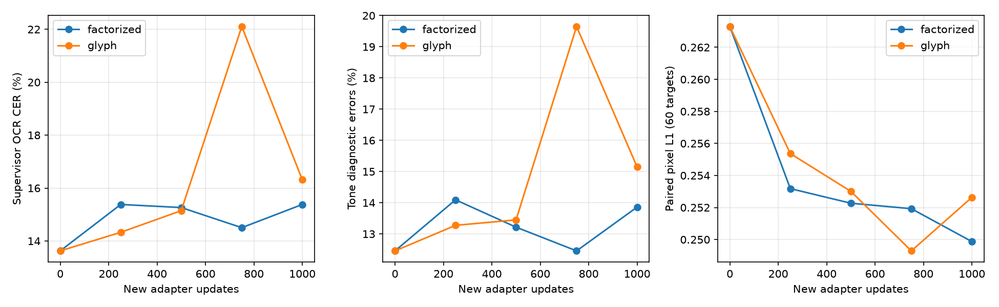

# VietCompose: measured pilot results and research status

## 1. What was run

Two 1,000-update adapter-only warm-start trials from legacy source checkpoint 175,500; same data, seed, image losses, frozen source G/D/OCR and evaluation schedule. This is adaptation of an already exposed model, **not a zero-shot experiment**. Both finished with exit code 0. Training/profile time: factorized 130.39 seconds; glyph control 125.33 seconds, excluding initial evaluation.

## 2. Results

| Model | CER, 600 prompts | Exact | Tone diagnostic error | Feature distance, 60 | Pixel L1, 60 |
| --- | --- | --- | --- | --- | --- |
| Unchanged source | 13.63% | 62.50% | 12.46% | 0.3304 | 0.2633 |
| Factorized, 1,000 updates | 15.38% | 60.83% | 13.86% | 0.3295 | 0.2499 |
| Whole-glyph, 1,000 updates | 16.32% | 57.67% | 15.15% | 0.3289 | 0.2526 |

**Interpretation:** the factorized adapter beats the adapted whole-glyph control by 0.94 percentage points of CER and 1.29 points of tone diagnostic errors at the final update. However, it is worse than the unchanged source by 1.75 CER points. Both arms continue to have 0/30 exact supervisor-OCR matches for standalone Ễ, Ắ and Ỡ. Lower paired pixel loss does not establish better handwriting.

This is mixed/negative evidence: explicit factor sharing is runnable and may make adaptation less harmful than a whole-glyph residual, but it has not improved the source model or solved the failure. One seed, limited budget, partially unmatched active parameters and training-supervisor metrics prevent statistical/general novelty claims. Fixed D is source-specific: do not compare its numerical distance against evaluators from earlier pilots using other D checkpoints.

The queue completed the factorized training, then encountered a summary-only filename parsing bug (`benchmark_references.json` was mistaken for a metric file). The parser was fixed and the queue explicitly resumed the pending glyph arm without rerunning the completed factorized training. All final trial exit codes and results are recorded.

## 3. Sample panels

[Unchanged source: 600-prompt panel](../../runs/vietcompose_pilot_v1/factorized/expanded/benchmark_000000.png).

[Factorized after 1,000 updates](../../runs/vietcompose_pilot_v1/factorized/expanded/benchmark_001000.png).

[Glyph control after 1,000 updates](../../runs/vietcompose_pilot_v1/glyph/expanded/benchmark_001000.png).

[Factorized: real / generated / support](../../runs/vietcompose_pilot_v1/factorized/visual/visual_001000.png).

## 4. V2 explicit ink compositor: engineering smoke only

The new layered renderer also completed a **300-update, one-font synthetic training check**. Six complete glyph combinations were omitted from the synthetic training targets, while their components remained represented in other glyphs. Mean held-out-font pixel L1 changed from **0.5328** at random initialization to **0.0714**. This only verifies a trainable compositional rendering graph.

These are canonical printed-font images, **not handwriting**. They use one constant style vector, no writer transfer, no strong competing baseline and a tiny target set. Prediction marks remain soft/imperfect. The small marks contribute little to global pixel error, so this score cannot establish diacritic correctness. Do not use this as a paper result for handwriting quality or superiority over VATr.

The renderer enforces a body path independent of tone/modifier labels, absence gates for missing marks, separate affine placement and a bounded word-level refiner. It is not integrated into a real-data GAN training pipeline. Training on genuine writers and proper matching baselines remains outstanding.

## 5. Verified implementation

- 18 unit tests passed, including the old Vietnamese tests.
- Source-zero residual preserved all 600 initial OCR predictions.
- Four-update GPU adapter smoke completed with finite losses.
- Both 1,000-update pilots completed; adapter checkpoints retained.
- V2 renderer unit tests and 300-update synthetic check completed.
- A clean holdout split was materialized, but the legacy trainer does not automatically enforce it. No clean real-handwriting zero-shot run has been performed.

## 6. Next decisions

1. Do not deploy or extend the adapted v1 checkpoint as an improvement. Keep the unchanged source as baseline.
2. Validate the full layered renderer under paired real handwriting with mark-aware ground truth/annotations and an independent evaluator; first resolve data and style supervision.
3. Implement a fresh leakage-controlled training pipeline before claiming compositional generalization. Use the prepared split consistently across target images, text corpora, OCR gradients and style supports.
4. Add body/mark placement annotations and a blinded human comparison. Repeatedly reducing internal CER or pixel L1 is not enough.
5. Treat uppercase held-out combinations separately: current genuine-writer data contains no real-image ground truth for several requested uppercase glyphs. Collect those samples if the paper claim includes their visual/style fidelity.

[Research proposal, prior art and architecture](RESEARCH_PROPOSAL.md). [Raw pilot CSV](pilot_metrics.csv). [Raw run comparison](../../runs/vietcompose_pilot_v1/comparison.json).
