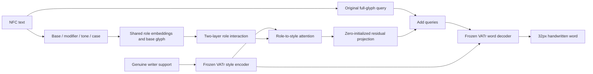
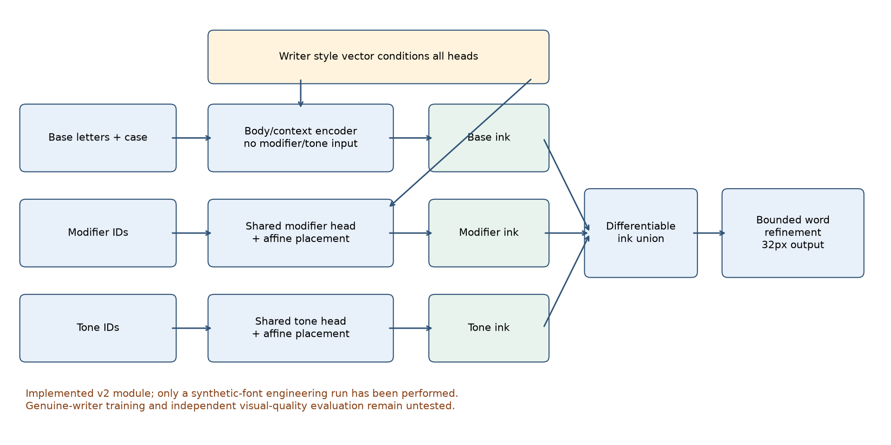

# VietCompose: Structured Orthographic Conditioning for Vietnamese Handwriting Synthesis

**Status:** research proposal, reviewed prior art, executable query-adapter prototype, and completed warm-start pilots. This is not a claim of a solved problem, publication novelty, or affiliation with MIT. No clean real-handwriting compositional generalization result has been established yet. The warm-start pilot is mixed/negative; see [measured pilot results](261114_report_02_Ket_qua_pilot_VietCompose.md).

## 1. Research question and diagnosis

Can a model learn the visual role of a Vietnamese mark from other letters and transfer it to a rare or unobserved combination in a new writer's handwriting, without sacrificing readability or visual quality?

Examples of orthographic structure:

| Glyph | Base | Modifier | Tone | Case |
| --- | --- | --- | --- | --- |
| A | a | none | none | upper |
| Á | a | none | acute/sắc | upper |
| À | a | none | grave/huyền | upper |
| Â | a | circumflex | none | upper |
| Ă | a | breve | none | upper |
| Ắ | a | breve | acute | upper |
| Ậ | a | circumflex | dot below/nặng | upper |
| Ễ | e | circumflex | tilde/ngã | upper |
| Ỡ | o | horn | tilde | upper |
| Đ | d | crossbar exception | none | upper |

The breve/circumflex/horn distinguish vowel letters; tone is a different role. Unicode NFD exposes the relevant combining marks, but Đ/đ needs an explicit rule. Canonical ordering can put dot-below before circumflex, so the parser classifies marks by identity rather than relying on sequence position. Source: [Unicode 17, Latin and Vietnamese](https://www.unicode.org/versions/Unicode17.0.0/core-spec/chapter-7/) and [Unicode normalization](https://www.unicode.org/reports/tr15/).

A correction to the initial premise matters: Á is not a new *word*, and it is not necessarily an independent image class in every generator. VATr already encodes visual glyph images rather than independent character IDs. Its linear glyph projection can share visual stroke evidence. The proposed improvement is **explicit role sharing and writer-conditioned interactions**, not discovering that glyphs can share pixels.

## 2. Evidence from our experiments—and what it does not prove

Our baseline reached 200k outer steps. Expanded-panel CER fell from 16.26% at 150k to 15.56% at the final checkpoint, with a 12.22% minimum at 174.5k and deterioration in the final window. Several uppercase single-character prompts remained unsuccessful according to the internal OCR. Auxiliary HAT reconstruction and paired feature/pixel losses did not consistently beat their controls.

The dataset audit found no genuine-writer training images containing Ê/Ắ/Ễ/Ỡ. HAT does contain those letters, but baseline G receives HAT transcripts and OCR gradients rather than those images as genuine-writer supervision. Thus we have simultaneous issues:

1. Missing visual examples for certain writer/letter combinations.
2. Weak or implicit parameter sharing across orthographic roles.
3. A frozen OCR supervisor that is imperfect and can reward unattractive but legible output.
4. Limited 32px input resolution and incomplete independent evaluation.
5. Legacy style feature layout, a separate unresolved architectural confound.

The old experiments establish a failure case; they do **not** identify role entanglement as the unique cause. Neither a lower loss nor an explicit decomposition guarantees better handwriting.

## 3. Related work and novelty boundaries

| Primary source | Established idea | Implication for this project |
| --- | --- | --- |
| [VATr, CVPR 2023](https://arxiv.org/abs/2303.15269) | Visual archetypes condition handwriting generation and share visual evidence across characters. | Essential baseline; cannot describe VATr as an independent one-hot model. |
| [VATr++](https://arxiv.org/abs/2402.10798) | Input preparation, regularization, and evaluation protocols affect styled handwriting synthesis. | Match data preparation and evaluation when comparing representations. |
| [DM-Font, ECCV 2020](https://arxiv.org/abs/2005.10510) | Compositional font generation using component memories on Korean/Thai settings. | Decomposing glyphs and reassembling components is prior art. |
| [LF-Font, AAAI 2021](https://arxiv.org/abs/2009.11042) | Local component-wise style features with factorization. | Explicit local style sharing is also prior art; compare its principles. |
| [MX-Font](https://arxiv.org/abs/2104.00887) | Multiple localized style experts with weak component supervision. | A serious alternative to hand-specified component-role encoders. |
| [WriteViT, 2025 preprint](https://arxiv.org/html/2505.13235v1) | Transformer-based handwriting generation with Vietnamese and English experiments. | Directly relevant Vietnamese baseline; results must be reproduced under compatible data access. |
| [HWD, BMVC 2023](https://arxiv.org/abs/2310.20316) | Handwriting-style evaluation in a learned feature space. | OCR CER alone is not a style-quality benchmark. |

This is a targeted review, not an exhaustive novelty search. Font synthesis is not identical to word-level handwriting: our target includes contextual mark placement, cursive/coarticulated strokes, a writer's variable word examples, and mixed seen/unseen combinations. Nevertheless, simply adding NFD embeddings is likely an incremental baseline rather than a strong paper by itself.

A defensible contribution would require evidence for:

- A leakage-audited **unseen orthographic combination × unseen writer** evaluation.
- A model showing a reproducible advantage over visual-glyph conditioning and appropriate compositional controls.
- Improved mark shape/placement and writer fidelity confirmed beyond the training OCR.

No “first Vietnamese compositional model” or state-of-the-art claim is made.

## 4. Implemented architecture: VietCompose-Query v1

### 4.1. Factorization

For each NFC character c, derive f(c) = (b, m, t, k): base, modifier, tone, case.

The implemented semantic vocabularies are:

- Modifier: none, circumflex, breve, horn, crossbar.
- Tone: none, acute, grave, hook above, tilde, dot below.
- Case: lower, upper, literal.

ASCII punctuation/numbers remain literal bases. Canonically equivalent NFC/NFD input maps to the same factors. Inputs outside the supported mapping raise an error; diacritics are not silently removed. The current generator still uses the existing 207-character alphabet, so this is not yet unrestricted open-vocabulary inference.

### 4.2. Role tokens and shared parameters

Use the native VATr glyph encoder P and base glyph g(b,k). Construct three role tokens:

```text
z_base  = down(P(g(base,case))) + case_embedding
z_shape = shape_embedding + role-coordinate embedding
z_tone  = tone_embedding  + role-coordinate embedding
```

The same tone embedding is used for acute on a, e, o, etc.; the same circumflex embedding is reused across a/e/o and cases. Two small transformer layers model the three-role interaction. Cross-attention to the existing writer-style memory supplies writer context. A fusion MLP outputs a residual content query:

```text
q_new(c, writer) = q_VATr(c) + up(fuse(role_tokens, writer_memory))
```

The residual output projection is initialized to zero. Installing the adapter therefore preserves the source content queries exactly before learning. The smoke experiment confirmed all 600 source benchmark OCR predictions were preserved at adapter step zero.

The query prototype adds **580,864 trainable parameters**. The original G, D, writer/OCR weights and normalization statistics are frozen during this pilot. This isolates adaptation of the query representation rather than another full GAN fine-tune.

### 4.3. What the coordinate priors mean

Upper modifiers, horn/right-side placement, and dot-below are assigned different coordinates before token embedding. These are **role-position priors**, not actual predicted pixel anchors. This version does not render three explicit ink layers or guarantee correct mark location. A learned geometric compositor is a proposed next architecture, described below.

### 4.4. Diagram of what actually runs



Implemented code: `research/vietcompose/orthography.py`, `model.py`, `losses.py`, `train_pilot.py`. The only change to the existing generator is an opt-in dispatch to `query_embed.compose`; native Unifont generation follows the existing path.

## 5. Training objectives in the running pilot

The pilot generates the transcript of a genuine-writer target using other images from the same writer as support. Target image is excluded and different transcripts are preferred. HAT is not used as a writer group.

```text
L = 1.0 L_pixel + 0.2 L_fixed-D-feature
  + 0.05 L_character-CTC + 0.05 L_component-CTC
```

Only the adapter is optimized, Adam LR 1e-4, gradient clip 5. There are no D/W/GAN updates. These are pilot coefficients, not optimal or publication-validated values.

Component CTC marginalizes the frozen OCR's Unicode probabilities into base/modifier/tone/case categories. CTC blank remains zero; the semantic category “none” is explicitly nonblank. This shares recognition evidence across precomposed characters, but the marginal streams can disagree in alignment. It is **not a separately trained factorized OCR**, and it is not independent evaluation. Character CTC and image losses are retained.

Image pairing has natural stroke variation even for one writer; pixel loss can blur. The fixed D feature proxy also has limitations. We keep these identical in both representation arms rather than claiming either loss resolves visual quality.

## 6. Experiments and controls

### 6.1. Warm-start pilot: completed, not zero-shot

Both arms start from the saved source checkpoint at legacy step **175,500**:

| Arm | Content conditioning | Budget |
| --- | --- | --- |
| factorized | base/modifier/tone/case role tokens plus residual glyph prior | 1,000 adapter updates |
| glyph | whole-glyph tokens through the same interaction/style/fusion backbone | 1,000 adapter updates |

Both use batch 8, same seed, same image losses, same frozen source networks, same 250-update evaluation interval. The control allocates the same modules but does not use the factor-embedding tables; it is a shared-backbone control, not a perfect match in effective active parameters. A parameter-matched arbitrary-code control should be added before a paper claim.

**Adapter update counts are not legacy GAN outer steps.** These trials are not “176,500 GAN steps.”

We report 600-prompt OCR proxy, 60-target fixed-feature/pixel proxy, per-prompt outcomes, component diagnostic errors, and side-by-side samples. No automatic promotion or conclusion of improvement is configured.

### 6.2. Clean composition protocol: prepared, not trained

Hold out the complete characters `Ễ,ễ,Ỡ,ỡ,Ẵ,ẵ`, while retaining training examples containing their primitives in other combinations. Audit of filtered data:

| Source | Clean indices | Reserved target-combination images |
| --- | --- | --- |
| Genuine writer train | 97,497 | 237 |
| HAT train | 101,866 | 667 |
| Development | 11,749 | 37 |

All six held-out characters have base, modifier, tone and case primitives covered in the remaining train+HAT pool. Coverage of individual primitives does not prove coverage of every pair or placement context. Case matters: the uppercase targets have no genuine-writer image ground truth in the present data.

To execute this protocol correctly, fresh training must exclude held-out combinations from:

1. Target handwriting images.
2. OCR training labels and image losses.
3. Generated transcript corpora.
4. Writer supports and retrieval memories.
5. Any pretraining with target handwriting exposure.

Existing 100k/150k/200k checkpoints **cannot** initialize the strict experiment because they have target exposure. The materialized split file is not automatically enforced by the legacy trainer. It is a protocol artifact for a future fresh training implementation.

Canonical glyph access is a separate assumption: VATr normally receives the target's printed visual archetype. A fair experiment must state whether this is allowed and provide equivalent canonical-glyph access to the relevant baselines. “Unseen target handwriting combination with canonical glyph available” is not “no target visual information at all.”

### 6.3. Four evaluation quadrants

- Seen writer, seen combination.
- Seen writer, unseen combination.
- Unseen writer, seen combination.
- Unseen writer, unseen combination.

Current data gives only 37 development words containing these target combinations; they are clustered by writer, not independent character trials. Broader holdout families and new uppercase handwriting examples are needed for robust conclusions. Pre-register target selection rather than changing holdouts after seeing test scores.

## 7. V2 explicit ink compositor: implemented, not validated on handwriting

`research/vietcompose/renderer.py` now implements `LayeredInkComposer`. It predicts separate base, modifier and tone ink fields. Base features receive only base-letter sequence, case, position and style; modifier/tone identities cannot enter that branch. Shared mark heads predict canonical ink patches and bounded affine geometry for composition onto a 32×16 character canvas. “None” explicitly gates mark ink to zero. Ink layers combine by `1 - product(1 - ink_layer)`.

A word-level convolutional refinement has residual magnitude bounded by 0.05, and padding is white. The body input uses factor IDs, not a whole-character table or target canonical glyph. A global style vector is accepted; a new local-component style memory is not implemented. Character cells and a small refiner still limit kerning/coarticulation.



Three additional tests check body-layer invariance when only marks change, empty mark layers, dot-below placement, padding and live gradients. The full suite now has **18 passing tests**. Geometry placement tests verify priors and differentiability, not learned correctness.

This renderer is separate from the running/adapted VATr query model. A 300-update one-font synthetic engineering run checks its training graph. It has not been trained on genuine writer handwriting or integrated into the legacy GAN trainer. It must not be described as a validated handwriting model.

Important constraints:

- Base-body features should not freely access tone identity; otherwise the base branch can hide the tone and defeat factorization.
- “No modifier/tone” should correspond to absent ink, not a learned arbitrary mark.
- Dot below, horn and stacked marks require different spatial support; not all marks go above the same center.
- Circumflex/acute/grave interactions may be offset rather than vertically stacked. Font-geometry priors cannot be treated as exact handwriting masks.
- A style-conditioned local mark memory needs genuine component evidence; unavailable components require uncertainty/fallback, not fabricated writer-specific supervision.
- Word-level continuity must survive character decomposition. Independent pasted character tiles are an inadequate handwriting solution.

This needs synthetic layered glyph supervision or curated mark/anchor annotations plus real handwriting adaptation. Font-rendered samples would be synthetic supervision, not additional real-writer evidence. The query adapter is the conservative warm-start experiment; the separate renderer is the more structural architecture requiring its own clean training and controls.

## 8. Required measurements before a paper

Content: independent OCR CER, exact words, and base/modifier/tone/case errors from aligned graphemes. Our current error function counts component mismatches after character edit alignment; insertions/deletions count for each role. It is transparent but alignment-dependent and still inherits evaluator errors.

Visual/style: blinded paired preferences, mark attachment/legibility annotation, writer-style agreement, and an appropriate independent feature metric such as HWD after validating domain suitability. Existing fixed-D distance is only a proxy. Independent OCR/HWD/human study have not run.

Generalization: per-combination macro results, lowercase-to-uppercase transfer, single-glyph versus natural-word prompts, and all four writer/combination quadrants. Do not let abundant unaccented letters dominate the aggregate.

Reliability: multiple seeds, writer-level bootstrap intervals, fixed test panel chosen in advance, equal training updates and data exposure, and coverage tables for both individual factors and their pairs.

Ablations: original VATr; whole-glyph residual adapter; arbitrary-code adapter; simple additive factor embeddings; factor interaction without style attention; without coordinate priors; without component CTC; proposed geometric renderer if implemented. Keep style-layout changes separate.

Failure criteria: lower internal OCR loss without better independent content/visual quality is not success; improvement only on reconstruction references is not writer transfer; improvement after exposed pretraining is not zero-shot composition.

## 9. Paper outline and claim policy

Working title is a project label, not a finalized publication claim. A useful paper structure:

1. Motivation: Vietnamese marks as structured roles, and measured failure of current baselines.
2. Related work: visual archetypes, component font synthesis, Vietnamese word generation, evaluation.
3. Task/protocol: compositional holdout, writer split and access assumptions.
4. Method: exact implemented architecture and objectives, with limitations.
5. Experiments: matched controls, independent metrics, seeds and qualitative failure cases.
6. Analysis: primitive coverage, case transfer, mark placement and style retention.
7. Limitations: missing writer-component evidence, low resolution, imperfect evaluators.

The pilot may refute the architecture. Negative results should trigger a revised hypothesis, not more steps or a changed metric until it appears favorable. The strongest potential contribution is verified compositional transfer with style fidelity—not the use of Unicode normalization itself.

## 10. Deliverables and current reproducibility

- [Protocol coverage audit](protocol/coverage.json).
- [Protocol split indices and leakage requirements](protocol/split_indices.json).
- [Component-family illustration](orthographic_families.png)—typeset examples, not model-generated handwriting.
- [Code and commands](../../research/vietcompose/README.md).
- [Completed pilot status](../../runs/vietcompose_pilot_v1/status.json).
- [Pilot comparison](../../runs/vietcompose_pilot_v1/comparison.json).
- [Measured pilot results and limits](261114_report_02_Ket_qua_pilot_VietCompose.md).

Smoke: 4 adapter updates on GPU completed in about 10.4 seconds after initial evaluation. All 600 initial OCR predictions matched the source checkpoint. Eighteen tests passed, including Unicode round-trip over the current alphabet, shared-tone gradients, padding, and semantic-none versus CTC blank. These verify implementation, not research effectiveness.

## 11. Final status of this implementation session

Both 1,000-update warm-start trials and the 300-update synthetic renderer smoke completed. [Measured results](261114_report_02_Ket_qua_pilot_VietCompose.md) show no improvement over the unchanged source on internal CER. Neither checkpoint is promoted. The explicit layered renderer is implemented/tested and trained only in the synthetic engineering check; real-handwriting and clean unseen-combination training remain future experiments.

Unknown writer metadata in HAT means cross-source human-writer independence cannot be guaranteed from pseudo IDs alone. The genuine-writer train/development ID split is explicit, but paper claims must acknowledge this remaining uncertainty.
