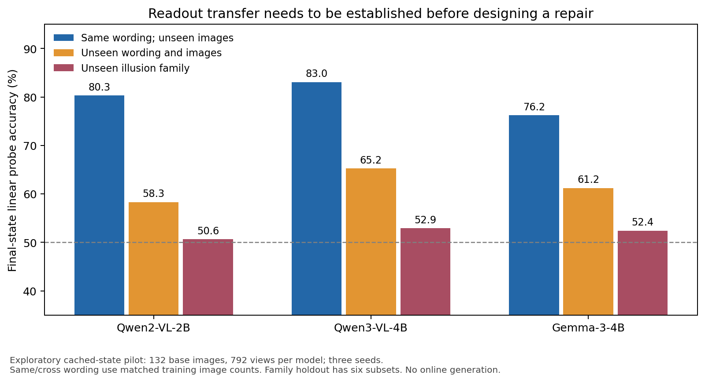

Đề xuất nghiên cứu cho SeeingNotSaying ver29 — 16/10/2026

Tôi khuyến nghị đầu tư vào **readout của bằng chứng thị giác có kiểm soát chuyển prompt**, kết hợp phân tích hình học candidate projection và một adapter chỉ bổ sung phần bằng chứng candidate logits chưa đọc được. Đây là hướng có thể xử lý đồng thời novelty, causal evidence và generalization. Tuy nhiên, một linear probe gắn vào output, một low-rank head hoặc tiếp tục tăng steering strength sẽ chưa đủ tạo đóng góp mới. Pilot bổ sung trong phiên này còn phát hiện readout hiện tại giảm mạnh khi đổi prompt và gần mức ngẫu nhiên khi chuyển họ ảo ảnh. Vì vậy cần chứng minh khả năng chuyển giao của bằng chứng trước khi đầu tư một chiến dịch repair lớn.

Đây là đề xuất phương pháp và kế hoạch kiểm chứng, **chưa phải phương pháp đã được chứng minh cải thiện generation**, và không phải cam kết điểm review. Những số liệu mới bên dưới là exploratory, dùng cache hiện có; không chỉnh sửa paper ver28 hay kết quả gốc.

**Cơ sở đánh giá.** Đã đọc PDF ver28 đủ 19 trang, gồm main paper và supplement, hai feedback được gửi; đối chiếu các luồng chính trong `pilot.py`, `gen_calib.py`, `diag_gen.py`, `diag_blank.py`, `ladder.py`, `steer_g3.py`, `alpha_select.py`, `cf_analysis.py`, `whatsup_pairs.py`, `stimuli.py`, audit hình học đã tồn tại và các protocol/report G1–R2. Đã kiểm tra nghiên cứu liên quan trên nguồn gốc arXiv đến ngày 16/10/2026. Có ba mức bằng chứng cần tách biệt: kết quả paper đã có; pilot mới đã chạy; giả thuyết cần thí nghiệm mới.

**Điểm giới hạn của bản hiện tại.** Hai feedback nhìn chung đúng rằng bài có thực nghiệm rộng và đối chứng tốt nhưng đóng góp chính vẫn là taxonomy vận hành. Section 4.4 chưa xác định duy nhất một cơ chế nội tại. Việc final-state probe giải được 84%/77% LOSS không tự chứng minh LM head xóa thông tin; việc steering đổi đáp án không tự chứng minh model vốn dùng cùng bằng chứng với probe. Steering α cố định chỉ đạt bar trên 2/4 held-out models, và chọn α theo validation cũng không cứu được mục tiêu. Đây là lý do nên đổi câu hỏi nghiên cứu từ “thêm intervention nào tăng accuracy?” sang “bằng chứng nào vắng khỏi kênh quyết định, có ổn định theo giao diện trả lời không, và có thể đưa nó vào kênh đó với tác động dự đoán được không?”.

| Feedback | Thực nghiệm có sức giải quyết | Giá trị đối với đóng góp |
|---|---|---|
| Novelty vừa phải | Phân biệt projection, pooling surface variants, decision rule và prompt-dependent readout; đưa ra dự đoán kiểm chứng được | Một kết quả khoa học cụ thể hơn empirical taxonomy |
| Thiếu causal identifiability | Counterfactual ảnh giữ nguyên câu hỏi/prefix; erase/restore phần bằng chứng nguồn; kiểm tra tác động lên native và repaired margins | Xác định ảnh hưởng của thành phần được đo trong phạm vi can thiệp |
| Prompt transfer yếu | Train/test đồng thời tách ảnh, template và verbalizer; đối chứng cùng lượng dữ liệu | Phân biệt feature ổn định với classifier học điều kiện prompt |
| Label dependence | Learning curve theo số ảnh gốc, và training bằng cặp synthetic có nhãn tự động | Định lượng chi phí thật; không gọi supervised synthetic là label-free |
| Nhãn từng lỗi chưa ổn định | Repeated grouped nested cross-fitting; xác suất nhãn và vùng chưa chắc chắn | Taxonomy có uncertainty thay vì nhãn cứng thiếu ổn định |

**Một phân biệt toán học quan trọng hơn việc chỉ thêm full-logit baseline.** Gọi h là trạng thái thực sự đi vào unembedding, sau final normalization; z = Wh + b là toàn bộ vocabulary logits trước các biến đổi bổ sung. Nếu W có full column rank, thì h = W†(z − b). Mọi linear probe trên h có một linear readout tương đương trên z trong số học chính xác. Do đó, hidden-state và full-vocabulary-logit recoverability bằng nhau trong trường hợp này là hệ quả đại số. Không nên trình bày nó như mechanistic discovery. Cũng không suy ra full rank chỉ từ việc vocabulary lớn hơn hidden dimension; cần kiểm tra rank và conditioning.

Nếu phân tích probabilities thay vì logits, cần xét thêm invariance của softmax với common shift. Với RMSNorm/LayerNorm, soft-capping, tied embedding scaling, quantization hoặc logits bị xử lý khi generation, phải dùng đúng phép biến đổi của model. Mệnh đề trên không áp dụng trực tiếp cho residual state trước normalization và không bảo đảm cùng sample efficiency dưới regularization khác nhau.

Chuỗi cần khảo sát là:

`final post-normalization state → all candidate surface-token logits → pooled class scores → class decision`.

Nên thêm các vocab-row subsets có kích thước cố định, được chọn trên training hoặc không cần nhãn, giữa bước đầu và candidate rows. “Top-k” thay đổi support theo từng item phải giữ token identities; không lấy danh sách giá trị đã sort rồi gọi đó là cùng một representation.

Với U_C gồm **tất cả** rows của các candidate surface tokens, đặt P_C = U_C†U_C và Q_C = I − P_C. Khi đó h = P_Ch + Q_Ch và U_CQ_Ch = 0. Phần Q_Ch vô hình đối với các candidate token logits ở đúng giao diện post-normalization đó. Vì thế nếu lớp readout đã kiểm tra dự đoán được từ Q_Ch nhưng không từ U_Ch, ta có bằng chứng về một giới hạn của kênh candidate được chọn. Chưa có kết luận rằng thông tin không tồn tại trong vocabulary khác, rằng nó thuần thị giác, hoặc rằng mọi decoder trên candidate scores đều bất lực.

Hai điều cần tránh: nullspace có hàng nghìn chiều nên giữ được signal là chưa bất ngờ; cần random subspaces cùng số chiều và capacity controls. Ngoài ra, một probe có weight ngoài rowspace không đủ chứng minh thông tin không thể dự đoán từ rowspace trên data manifold, vì các thành phần có thể tương quan.

**Pilot mới đã chạy trên cache.** Script mới `cached_geometry_pilot.py` dùng CPU, không tải model, không chạy thêm VLM, không sửa cache gốc. Các model: Qwen2-VL-2B, Qwen3-VL-4B, Gemma-3-4B. Mỗi model có 792 views nhưng chỉ **132 ảnh gốc**, mỗi ảnh gồm hai wording × ba resolutions. Ba seeds, 5-fold theo ảnh gốc, stratify theo (illusion subset, label). Hạng của union candidate rows là 8 ở cả ba model. Classifier cố định StandardScaler + LogisticRegression(C=1), chỉ dùng final answer-position state; không chọn layer theo test. Đây không phải tái lập chính xác Adam probes của paper.

| Model | Raw | LR trên pooled scores | LR trên candidate rowspace, 8 chiều | LR trên candidate nullspace | LR trên final hidden state |
|---|---:|---:|---:|---:|---:|
| Qwen2-VL-2B | 50.0 | 45.1 | 49.1 | 81.0 | 80.6 |
| Qwen3-VL-4B | 54.2 | 54.4 | 60.1 | 85.3 | 85.5 |
| Gemma-3-4B | 52.7 | 47.1 | 49.7 | 76.3 | 76.2 |

Các giá trị là accuracy %, trung bình ba seeds. Calibrator ở đây pooled toàn bộ subsets, được đánh giá cùng classifier và folds với các readout khác; paper còn có calibrator per-subset. Vì vậy không thay thế số trong Table 5/6 bằng bảng này. LR thấp hơn raw có thể do finite-sample fitting; deployment phải có baseline giữ raw. Không diễn giải các giá trị dưới 50% thành bằng chứng “âm thông tin”.

Random subspace cùng hạng 8 đạt lần lượt 48.2%, 55.7%, 49.4%; random 32 chiều đạt 55.8%, 60.2%, 55.7%. Pilot chưa thấy candidate rowspace vượt trội lớn so với các control này, nhưng nullspace giữ gần đủ accuracy của full-state probe. Kết quả phù hợp với hướng khảo sát candidate observability; không chứng minh một “visual nullspace” đặc thù. Seed thay đổi cả fold lẫn random basis, nên độ dao động của random baselines gồm hai nguồn này.

Native-row reconstruction từ cached float16 states đạt argmax agreement khoảng 99.5–100%; score MAE khoảng 0.03–0.06. Residual candidate logits sau projection null có trị tuyệt đối tối đa khoảng 2.27×10⁻⁵ trong FP32. Đây là kiểm tra đại số/số học; không thay cho online intervention trên model gốc. Can thiệp trước final norm có thể đổi logits dù vector trực giao với native rows, do normalization.

Kết quả quan trọng hơn xuất hiện khi kiểm tra transfer:

| Model | Final-state probe, cùng wording | Final-state probe, đổi wording | Final-state probe, giữ riêng một họ ảo ảnh để test |
|---|---:|---:|---:|
| Qwen2-VL-2B | 80.3 | 58.3 | 50.6 |
| Qwen3-VL-4B | 83.0 | 65.2 | 52.9 |
| Gemma-3-4B | 76.2 | 61.2 | 52.4 |

Hai cột wording dùng cùng số ảnh và views huấn luyện: train wording A/test A đối chiếu train A/test B, và chiều ngược lại; tất cả test images đều chưa thấy. Do đó mức giảm không chỉ do giảm một nửa dữ liệu khi bỏ một wording. Cột cuối là leave-one-illusion-subset-out trên sáu subsets, báo cáo trung bình theo items; không phải sáu dataset độc lập. Family-holdout deterministic đối với các features cố định nên lặp seed không tạo thêm evidence độc lập.

Paired bootstrap theo 132 ảnh, sau khi lấy trung bình correctness qua ba seeds và hai chiều chuyển prompt, cho mức giảm cùng-wording trừ đổi-wording: Qwen2 22.0 điểm [16.3, 27.6], Qwen3 17.8 [13.1, 22.1], Gemma 15.0 [10.7, 19.2]. Đây là intervals có điều kiện trên các fitted models; chưa bao gồm bất định của việc lấy mẫu lại training set rồi refit.



Diễn giải có thể bảo vệ: **readout tốt trong một giao diện trả lời không đồng nghĩa một kênh bằng chứng có thể sử dụng ổn định khi giao diện đổi**. Pilot chưa chỉ ra nguyên nhân của sự phụ thuộc này: prompt geometry, generated prefix, dataset features hay regularization đều còn có thể góp phần. Nó chưa phủ định kết quả best-layer probes của paper, vì ở đây dùng cố định final state và một classifier khác. Tuy nhiên, nó là lý do mạnh để không dùng “probe tốt” làm căn cứ duy nhất cho một universal repair.

**Nghiên cứu gần nhất và chỗ cần tạo khác biệt.**

| Nguồn gốc đã kiểm tra | Phạm vi liên quan | Hệ quả cho ver29 |
|---|---|---|
| [HeadEdit, 01/10/2026](https://arxiv.org/html/2610.01170v1) | Low-rank behavioral subspace từ paired completions; thay gain ở pre-unembedding state, tạo state-dependent vocabulary-wide correction | Chỉ đề xuất low-rank final readout edit sẽ rất khó bảo vệ novelty |
| [Koushik et al., 16/09/2026](https://arxiv.org/html/2609.18860v1) | Phân biệt probe-discriminative/output-routed features; có direct logit routing và probe-distilled LoRA | Cộng probe score vào native margin đã có tiền lệ trực tiếp |
| [TVER, 13/10/2026](https://arxiv.org/html/2610.17663v1) | Giữ reasoning trace, chuyển bounded attention từ text sang image patches khi đọc final answer | Baseline quan trọng nếu mở rộng sang fixed-trace reasoning; cùng sửa answer step là chưa mới |
| [Evidence Anchoring Boundary, 09/10/2026](https://arxiv.org/html/2610.12981v1) | Equal-RMS intervention theo depth, tách intervention leverage khỏi answer stabilization; calibrated selective routing | Hand-off curve và “gate trước khi sửa” đã có nghiên cứu gần |
| [Seeing, Saying, but Not Using, 02/10/2026](https://arxiv.org/abs/2610.02876) | Availability–utilization trong spatial state transformations; Operational State Supervision | Cần tách failure đọc đáp án khỏi failure thực hiện tính toán trên state |
| [LEACE](https://arxiv.org/abs/2306.03819), [ReFT](https://arxiv.org/abs/2404.03592) | Concept erasure và learned low-rank representation interventions | Projection, erasure và low-rank intervention tự thân không phải ý tưởng mới |
| [Nullu](https://arxiv.org/abs/2412.13817), [GGSS](https://arxiv.org/abs/2608.25375) | Hallucination-subspace projection; spherical/gated steering cho generative VLM | Có các baseline geometry-aware trước khi so với mean-difference steering |

HeadEdit và các nguồn HTML đầu bảng đã được đọc phần phương pháp liên quan; Nullu, GGSS và bài spatial ở bảng này được kiểm tra ở mức abstract, cần đọc sâu trước khi tái lập baseline. Không khẳng định hướng đề xuất là “đầu tiên” chỉ từ lượt tìm kiếm này.

Cần audit lại Related Work của bản thảo. Nguồn Koushik hiện đọc báo cáo 93.3% gap recovery cho **router kết hợp native margin và hidden probe score**. Đại lượng đó khác output-only threshold calibration; không dùng để thay máy móc con số 69.8% hiện trong bản thảo. Cần truy ngược đúng phiên bản/bảng cho số 69.8 và mô tả chính xác thông tin mỗi baseline được truy cập. Điểm trùng đáng quan tâm là paper đó đã làm cả feature-output separation và recovery; không chỉ một threshold baseline.

**Phương pháp tôi đề nghị thử: adapter readout dùng bằng chứng ảnh đối chứng và ổn định theo prompt.** Tên mô tả tạm thời: *counterfactual, prompt-consistent residual readout*. Đây là một giả thuyết thiết kế, chưa phải thuật toán có kết quả. Giá trị mới cần đến từ việc định nghĩa được nguồn bằng chứng, ràng buộc được phần sửa, và dự đoán được transfer; tên gọi hay việc ghép vài loss không tạo novelty.

1. **Tách ba biến độc lập.** Tạo cùng một scene có ảnh gốc/counterfactual, nhiều cách hỏi tương đương, và nhiều cách mã hóa đáp án. Ví dụ ý nghĩa “hai đoạn bằng nhau” có thể được trả bằng Yes/No hoặc code A/B theo mapping ngẫu nhiên được nêu trong prompt. Không thay đổi ý nghĩa câu hỏi khi gọi đó là paraphrase. Chọn seed scene, template và output mapping thành các trục holdout riêng. Ground truth synthetic được tạo tự động, nhưng vẫn là supervision.

2. **Đo state tại cùng ngữ cảnh.** Để cách ly ảnh, h(I,q,prefix) và h(I_cf,q,prefix) phải dùng chính xác cùng prefix. Có một thí nghiệm với fixed answer marker, và một thí nghiệm online với prefix model thực sự sinh. Giữ fixed prefix cho image contrasts rồi mới đo; không lấy state cuối prompt blank-image trừ state ở decision step sau reasoning của ảnh thật rồi coi đó là pure visual residual.

3. **Học phần bằng chứng còn thiếu thay vì thay toàn bộ classifier.** Đặt a(x)=A s̄(x)+b là output-only baseline, với s̄ là scores đã center theo candidates. Chọn candidate rows và Q_C như trên. Một visual contrast có thể là v(x)=Q_C[h(I,q,prefix)−h(I₀,q,prefix)], trong đó I₀ là control image. Dùng nhiều loại control (blank, unrelated, matched image), vì blank có thể ngoài phân phối. Với một cơ sở V nằm trong nullspace candidate, đề xuất f(x)=a(x)+g(x) R Vᵀv(x). Mapping về semantic classes phải được đảo về canonical order trước khi tính consistency giữa các verbalizers.

4. **Học V và R bằng paired changes.** Các counterfactual ảnh chỉ đổi thuộc tính liên quan tạo Δv; chọn subspace trên training pairs, rồi học một readout nhỏ. Loss gồm supervised CE, margin đúng chiều trên visual pairs, và consistency qua paraphrases sau canonicalization. Thử lần lượt từng ràng buộc để biết phần nào thực sự giúp. Rank, regularization và loss weights chọn ở inner development split. Không áp đặt “cross-task universal subspace” nếu chưa có bằng chứng. Với bài binary, một classifier tuyến tính vốn chỉ có một discriminant direction: rank-1 không tự là phát hiện low-dimensional mechanism.

5. **Đưa vào generation ở đúng output interface.** Thử bản trực tiếp bổ sung candidate scores trước. Sau đó, nếu cần kiểm tra bằng một state intervention, tìm δh nhỏ sao cho U_Cδh khớp correction target; lời giải minimum-norm dùng pseudoinverse khi target nằm trong image của U_C. Với nhiều surface variants hoặc soft-capping phải xử lý đúng constraints. Đây là constructive baseline cho observability/control, không phải bằng chứng model gốc đã sử dụng signal đó. Can thiệp trên trạng thái post-normalization sẽ có ý nghĩa khác can thiệp layer output ở 75% depth.

6. **Chọn sửa dựa trên expected utility đã hiệu chuẩn.** Nhãn BIAS/LOSS/PERC dùng gold nên không thể dùng trực tiếp làm gate khi inference. Gate g chỉ dùng score margin, residual-readout confidence, mức agreement và các đặc trưng đã xác định trên training/calibration. Calibrate khả năng sửa đúng và phá đáp án đúng trên dữ liệu riêng. Fallback có thể là raw hoặc output-only calibrator, chọn bằng development data. Threshold chỉ là cam kết thực nghiệm dưới phân phối đánh giá; không hứa risk bound dưới domain shift.

Phần này giải quyết BIAS bằng a(x), cố tận dụng recoverable LOSS bằng residual correction, và giữ nguyên các trường hợp chưa có bằng chứng sửa hữu ích. **PERC không được giải quyết triệt để bằng một output adapter.** Nếu mở thêm crop/re-encode hoặc công cụ đo ảnh, phải công nhận đó là nhánh bổ sung thông tin và tính đúng chi phí; không gộp vào claim “chỉ sửa readout”.

**Các kiểm tra có thể bác bỏ chính phương pháp.** Đầu tiên đánh giá liệu correction học từ training pairs có giữ đúng hướng khi đổi ảnh trên template và scene chưa thấy. Tiếp theo erase phần Vᵀv rồi đo mất lợi ích của repaired model; restore cùng phần hoặc dùng counterfactual donor phù hợp rồi đo hướng đổi margin. So với random source cùng rank/norm, shuffled labels ở cấp scene, donor cùng nhãn, và source từ blank/shuffled images. Các can thiệp native cần đo riêng với can thiệp repaired model.

Việc xóa Q_Ch không đổi native candidate logits là tautology tại giao diện đã định nghĩa. Phát hiện thực nghiệm phải là **thành phần task-relevant trong đó phản ứng đúng với ảnh thật và cho phép sửa chuyển giao với mức damage thấp**, vượt các controls và baseline. Cũng không tuyên bố erase làm “mất toàn bộ concept” nếu chỉ xóa một fitted linear direction. Nếu repaired output bị buộc nghe theo probe, việc output theo probe cũng không xác nhận đúng một native causal mechanism.

**Năm vấn đề code/protocol nên xử lý trước khi chạy study lớn.**

| Chỗ trong code | Quan sát | Thay đổi cần có |
|---|---|---|
| `diag_gen.py:116–129` | Calibrator per-subset, probe pooled; folds được tạo lại theo từng tập con | Một fold manifest toàn cục; global/per-subset và cùng lượng nhãn cho cả hai readouts; báo cáo cả hai lựa chọn |
| `gen_calib.py` và `vlmbias_grouped.py` so với `pilot.probe_cv` | Generation LR center từng score vector; diagnostic LR standardize feature nhưng giữ common-mode information | Ladder offsets → positive diagonal scaling → full affine, và centered/uncentered features; thống nhất định nghĩa hoặc giải thích khác biệt |
| `diag_blank.py:run` | Blank-image states lấy ở cuối prompt; `diag_gen.py` lấy states ở generation decision step | Lưu prefix token IDs và decision index, tạo controls tại cùng prefix; giữ thêm prompt-final control riêng |
| `alpha_select.py` đọc `*_steergrid.npz` rồi mới chia val/test | Grid được tạo bằng các probes/class means cross-fit từ trước; split chọn α không refit cả pipeline | Outer train/calibration/test; mọi probe, means, scaling và α fit trong đúng outer training/calibration. Không gọi đây là locked test chỉ vì α được chọn trên nửa khác |
| `ladder.py:107–108` | Seed analysis tổng hợp số cells/Rec, chưa lưu nhãn từng lỗi qua repeats | Lưu per-item OOF probabilities, selected layer và label per repeat; trực tiếp đo stability |

Điểm về steering-grid selection là vấn đề nesting: dự đoán OOF của từng item không dùng nhãn chính item đó, nhưng predictors cho validation có thể đã dùng nhãn của nhiều items sau này được gọi là test. Chọn α trên các dự đoán đó tạo dependency không phù hợp với một outer locked evaluation. Đây chưa phải định lượng bias của kết quả cũ; cần chạy lại đúng nested procedure để biết ảnh hưởng.

Với stability, dùng nhiều repeated grouped outer splits, giữ item prediction luôn OOF, chọn layer/regularizer ở inner folds. Báo cáo p_BIAS(x), p_LOSS(x), p_PERC(x), entropy, agreement và tỷ lệ “chưa đủ ổn định”. Các xác suất này mô tả bất định của procedure/fit trên một item, không phải posterior về nguyên nhân nhân quả. Bootstrap cluster theo scene/image và báo cáo theo model family/dataset; không coi mọi model×task cell độc lập.

**Study tối thiểu đáng đầu tư cho ver29.**

| Giai đoạn | Việc làm và sản phẩm | Điều quyết định tiếp tục |
|---|---|---|
| 1. Audit cache | Đồng nhất folds, readout ladder, all-variant/margin/common-mode controls; stability; xác nhận pilot với optimizer paper | Có signal gap ổn định, không do fit budget hoặc pooling đơn thuần |
| 2. Controlled extraction | Ảo ảnh thủ tục + spatial scenes; paired original/counterfactual, nhiều paraphrases và verbalizers; cố định prefixes; nhóm theo source scene | Evidence changes đúng theo ảnh trên scenes/templates mới |
| 3. Prototype | Output calibration + residual readout; pair/consistency ablations; image controls | Vượt full-state probe/direct routing ở transfer, hoặc ngang accuracy với ít nhãn/damage hơn |
| 4. Confirmatory repair | Freeze method trên development models; models hoặc dữ liệu mới; full generation và paired metrics | Gain vượt strongest baseline và damage trong giới hạn được đăng ký trước |
| 5. Scope extension | Một task với đáp án nhiều token; score cả candidate strings/answer spans, không chỉ first-token proxy | Giữ được kết luận khi đổi verbalizer/độ dài đáp án; nếu không thì giới hạn scope |

Đề nghị development: các model đã pilot trong phiên này; Qwen2-VL-2B từng là held-out ở ver28 nhưng nay đã được xem kết quả nên **không còn là untouched confirmatory model cho ý tưởng ver29**. Có thể dùng các model khác đã tồn tại để test thuật toán nếu freeze lựa chọn trước khi xem kết quả thuật toán mới, và nói rõ chúng từng được dùng trong paper. Không gọi toàn bộ model family là unseen nếu đã chọn thiết kế theo các sibling models. Với data, giữ một test set scene/template thật sự mới; VLMBias 132 ảnh thích hợp development hơn một kết luận damage thấp rất chắc chắn.

Baselines bắt buộc: raw, restricted-candidate raw, REMAP, majority, output-only offset/positive-diagonal/full affine, expanded candidate surface tokens, full-state linear probe, direct logit routing theo probe, mean steering, HeadEdit trong setting tương thích, và adapter cùng parameter/label budget nhưng không có geometric/pair/consistency constraints. TVER là baseline bổ sung khi dùng fixed reasoning trace; LoReFT/LoRA là đối chứng nếu claim lợi thế so với adaptation. Mọi method dùng cùng train labels/images, preprocessing và split; báo rõ số lần forward, runtime, trainable parameters và persistent storage.

Một gate chỉ giảm damage bằng cách hầu như không sửa phải hiện trên coverage–gain–damage curve. Báo cả full-set accuracy, both-correct trên visual pairs, performance theo prompt/verbalizer mới, calibrated reliability, broken/fixed counts và intervals. Không dùng accuracy chỉ trên original errors làm metric chính. Pairwise image controls cần đủ độc lập, không chỉ đổi resolution hay đặt lại cùng ảnh.

Các ngưỡng sau là **mục tiêu đề nghị cho study mới**, chưa được đăng ký trước hay xác nhận: trên LOSS-heavy held-out settings, tăng ít nhất 10 điểm so với max(raw, strongest output-only baseline), đồng thời có lợi thế rõ so với generic direct routing về transfer hoặc label/damage budget; trên BIAS-heavy settings không kém calibration quá 1 điểm; trên neutral/correct cases hướng tới broken ≤2%; giữ ít nhất 70% in-template gain khi chuyển template. Ngưỡng phải được chốt một lần theo mục tiêu khoa học và power trước confirmatory runs, không tiếp tục điều chỉnh sau khi thấy test results. Không cần ép cùng một ngưỡng cho mọi dataset nếu metric và baseline ceiling khác nhau.

Về power: nếu không có broken event nào trên n independent correct examples thì upper one-sided 95% binomial bound là 1−0.05^(1/n). Với n=66 bound vẫn khoảng 4.44%; cần khoảng 150 correct examples độc lập để bound dưới 2% ngay cả khi không phá câu nào. 792 repeated views không tạo 792 independent trials. Thiết kế mới nên có vài trăm scene gốc cho mỗi test regime và lên kế hoạch power theo số correct examples/group dependency, không chỉ theo tổng số questions.

Ưu tiên một study nhỏ có holdout đúng trước khi mở rộng nhiều model. Ước lượng làm việc, chưa benchmark runtime: audit CPU 1–2 ngày làm việc; xây controlled extraction/prototype vài ngày; confirmatory runs thêm vài ngày tùy model size và khả năng cấp GPU. Trong phiên này cả hai H200 đang được dùng gần đầy nên chỉ chạy cache CPU. Không có căn cứ đủ tốt để cam kết GPU-hours cụ thể trước khi benchmark extraction trên 20–50 scenes.

**Khi nào nên dừng hướng method.** Nếu candidate observability gap biến mất khi mở rộng surface variants hoặc cân bằng fit budget, nên pivot sang output-interface diagnosis. Nếu residual vẫn có signal trong cùng prompt nhưng không chuyển qua template/scene mới dù thêm pair/consistency training, không dùng nó làm universal repair. Nếu HeadEdit/direct routing đạt cùng gain với cùng labels và damage, đóng góp còn lại phải là cơ chế/protocol đo được; không đổi tên adapter để coi là algorithm mới. Nếu gain cần mở lại ảnh hoặc semantic solver, hãy trình bày thành evidence acquisition, đánh giá riêng với readout repair.

**Cách viết lại bài khi có kết quả.** Giữ taxonomy làm nền và benchmark controls làm bằng chứng chất lượng đánh giá. Đưa phát hiện chính lên trước: khả năng khôi phục từ output phụ thuộc candidate projection và output interface; đo riêng bằng chứng ổn định theo ảnh và theo prompt; chỉ những signal vượt transfer controls mới hướng dẫn được repair. Sau đó trình bày intervention cụ thể và held-out predictions. Rút bớt reproduction audit khỏi main nếu cần chỗ cho causal/transfer figures. Đừng đổi toàn bộ bài thành một adapter paper trước khi adapter thắng baseline mạnh.

Một claim ứng viên, chỉ dùng sau khi có bằng chứng: “Candidate-logit calibration and hidden-state recoverability characterize different output interfaces; controlled visual contrasts identify which recoverable evidence supports correction across unseen prompts.” Nếu study không chứng minh correction across prompts thì bỏ mệnh đề sau, giữ kết quả giới hạn. Mức review tăng đến đâu phụ thuộc kết quả thực nghiệm và reviewer; không có cơ sở để quy một số điểm chắc chắn cho hướng này.

**Artifact và cách tái lập pilot.**

- `mllm_readout/cached_geometry_pilot.py`: source CPU pilot, fixed classifier/hyperparameters, assertions chống rò ảnh/wording.
- `mllm_readout/results/ver29_cached_pilot/`: 252 metric rows, prediction arrays và metadata cho bốn protocols đầu tiên.
- `mllm_readout/results/ver29_cached_pilot_matched/`: 126 metric rows cho hai same-wording controls; cùng seeds và folds.
- `ver29_pilot_summary.csv`: bảng aggregate của hai lượt chạy.
- `ver29_prompt_transfer_paired.csv`: paired image-bootstrap gaps.
- `ver29_transfer_pilot.png` / `.pdf`: hình để đọc/xuất.

Để tái lập toàn bộ sáu protocols trong một output directory mới:

```bash
mllm_readout/.venv/bin/python mllm_readout/cached_geometry_pilot.py \
  --out /tmp/ver29_cached_geometry_reproduction
```

Mặc định chạy ba models × ba seeds. Cần cache model/tokenizer và states hiện có; script không tạo model inference. Hai lượt trong phiên này đều hoàn thành thành công; source đã qua `py_compile`, asserts kiểm tra grouped splits và vocabulary reconstruction được lưu trong metadata. Raw outputs nằm trong `results/`, vốn được repo gitignore; các bảng tóm tắt và báo cáo trong `docs/` giúp giữ lại bằng chứng đọc được.
